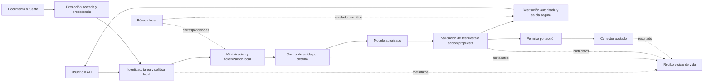

# Regulae y Vigía 13: capacidades de seguridad y gobierno que merecen construirse

Propuesta de producto e investigación, 2 de octubre de 2026. **No es un compromiso de implementación ni una auditoría de seguridad.** Investigación del repositorio y de fuentes primarias; no se han ejecutado benchmarks, proveedores de pago ni cambios de aplicación. Las prioridades son juicio de producto, no resultados medidos.

Mi recomendación es construir una plataforma que pueda responder, para cada operación: **quién puede usar qué datos, para qué tarea, con qué modelo o herramienta, qué salió realmente y qué controles se aplicaron**. Regulae ofrece ese núcleo de forma accesible; Vigía 13 añade privacidad reversible, gobierno entre equipos y operación corporativa.

El salto ambicioso consiste en conservar controles útiles incluso cuando el modelo interpreta una instrucción maliciosa como legítima. La detección semántica ayuda a descubrir ataques; los permisos, la restitución de datos y la ejecución deben seguir bajo control del programa.

## 1. Los planes encontrados y el punto de partida

El índice está en [plan-blackhat/README.md](plan-blackhat/README.md). Ya contempla:

| Planes existentes | No contarlos como ideas nuevas |
| --- | --- |
| 01–03 | Fallo cerrado, historial autorizado, confirmaciones, idempotencia y un único envío web/API |
| 04–05 | Cobertura documental y clasificación YARA + Jev |
| 06–07 | Router por tarea/coste y verificación con un segundo intento como máximo |
| 08–09 | Ficha de decisión y citas verificables |
| 10–12 | Simulación de políticas, evaluación reproducible y demo |

La distinción importa: propuestas como «añadir auditoría», «poner otro modelo a revisar» o «elegir el modelo barato» repetirían trabajo ya planeado.

El índice describe la base `6a0f667`; el HEAD observado durante esta investigación es `75ec8678804636ecbce5e97fa6c88f851c139209`, rama `codex/community-blackhat`, con cambios locales. Hay código en desarrollo en `front/chat_service.py`, `policy.py`, `routing.py`, `verification.py`, `documents.py`, `jev.py` y `chat_ui.py`, además de pruebas. **Existencia del código no demuestra entrega completa.** [Estado de ejecución](plan-blackhat/estado-ejecucion.md) y [tarea de envío seguro](plan-blackhat/tareas/01-envio-seguro.md) todavía documentan trabajo pendiente. No he vuelto a ejecutar sus pruebas en este encargo.

Por lectura, hay puntos naturales de integración: [envío compartido](../regulai/front/chat_service.py), [política local](../regulai/front/policy.py), [verificación](../regulai/front/verification.py), [modelos existentes](../regulai/front/models.py) y [ficha exportable](../regulai/front/chat_ui.py). Podemos ampliar esos puntos sin sustituir Django ni crear otro orquestador.

La tokenización reversible ya es una idea del usuario y estaba expresamente excluida de Community. Aquí la desarrollamos como apuesta Enterprise; no la presentamos como descubrimiento nuevo.

## 2. Skills investigadas y método creativo

He seleccionado métodos por encaje con este trabajo; no existe en esta investigación una comparación experimental que permita llamarlos «los mejores» universalmente. No se han instalado ni ejecutado paquetes externos.

| Skill / fuente original | Qué aporta a este encargo | Cómo la he utilizado |
| --- | --- | --- |
| [Superpowers: brainstorming](https://github.com/obra/superpowers/blob/main/skills/brainstorming/SKILL.md) | Entender propósito, contexto y alternativas antes de implementar | Referencia de proceso; la petición ya define propósito y no necesita otra entrevista |
| [SCAMPER](https://github.com/danium/lateral-thinking/blob/main/skills/scamper/SKILL.md), con su banco de preguntas y ejemplo | Transformar sistemáticamente un producto existente | Técnica de ideación para salir de «otro filtro y otro panel» |
| [Trail of Bits: sharp-edges](https://github.com/trailofbits/skills/tree/master/plugins/sharp-edges) | Buscar configuraciones y APIs que inducen a errores de seguridad | Referencia para exigir defaults seguros y permisos difíciles de usar mal |
| [OpenAI: security-threat-model](https://github.com/openai/skills/blob/main/skills/.curated/security-threat-model/SKILL.md) | Activos, límites de confianza y rutas de ataque ligados al código | Referencia de contraste; no se ha ejecutado una auditoría formal |
| Skills locales `question-vs-task` y `calibrated-recommendation` | Separar investigación de implementación y recomendación de evidencia | Aplicadas para proponer capacidades sin dar por probada su eficacia |

El ejercicio SCAMPER produjo estas líneas:

| Transformación | Pregunta útil | Resultado |
| --- | --- | --- |
| Sustituir | ¿Qué cambia si el proveedor recibe relaciones en lugar de identidades? | Tokenización coherente por expediente y procesamiento dividido local/remoto |
| Combinar | ¿Qué ganamos si la ficha conoce también origen y caducidad del dato? | Evidencia de decisiones vinculada al ciclo de vida |
| Adaptar | ¿Qué podemos traer del control de acceso de sistemas operativos? | Permisos temporales y concretos para cada acción |
| Modificar | ¿Qué vemos si observamos una sesión entera y no un único prompt? | Riesgo acumulado y detección de extracción progresiva |
| Otros usos | ¿Sirven los casos adversariales para algo más que la demo? | Laboratorio de regresión para cambios de política y proveedor |
| Eliminar | ¿Qué componente podemos quitar sin perder protección? | Sin propuesta independiente: la simplificación relevante ya está en los planes |
| Invertir | ¿Y si primero autorizamos la operación y después pedimos al modelo que la complete? | Refuerza el permiso por acción; se integra ahí, sin duplicar funcionalidad |

## 3. Dónde está la oportunidad competitiva

Ya existen [políticas y guardrails en LiteLLM](https://docs.litellm.ai/docs/proxy/guardrails/guardrail_policies), [controles en distintas fases en NeMo Guardrails](https://docs.nvidia.com/nemo/guardrails/about-nemo-guardrails-library/rail-types), [escáneres en LlamaFirewall](https://github.com/meta-llama/PurpleLlama/blob/main/LlamaFirewall/README.md) y [guardrails en Portkey](https://portkey.ai/features/guardrails). [Lakera también documenta controles sobre comportamiento y herramientas](https://docs.lakera.ai/docs/agent-behavior-defense). Son descripciones de sus autores, no una comparación independiente de eficacia.

Por eso, «tenemos un detector de prompt injection» es una capacidad necesaria, pero insuficiente como argumento diferencial. La hipótesis comercial más fuerte es **hacer viable el trabajo con información sensible desde infraestructura controlada por el cliente, con permisos y evidencia que se entiendan y se puedan comprobar**. No he demostrado que esa combinación sea exclusiva en el mercado.

El comprador de Vigía 13 pagaría por habilitar un proceso que hoy tiene prohibido, reducir trabajo de auditoría y operar muchos equipos bajo normas consistentes. Conviene validar esa hipótesis con empresas antes de invertir en todas las integraciones.

## 4. Seis apuestas principales

### A. Tokenización local con restitución autorizada — Vigía 13

Partimos del ejemplo del usuario: sustituir el DNI por un identificador, procesar fuera y devolver el original localmente. Lo convertiría en una **bóveda de correspondencias por expediente**, con autorización separada para revelar cada categoría de datos.

Ejemplo sintético: «La persona [PERSONA_X7] con [DNI_P9] firma el contrato de [EMPRESA_R2]». El proveedor recibe relaciones útiles sin necesitar el identificador original. Dentro del expediente, una misma entidad conserva su referencia; fuera de él, no se reutiliza por defecto. Los alias visibles son una representación de identificadores opacos generados localmente, no claves globales predecibles como `DNI1`.

Para que sea una capacidad de seguridad real:

- Detectamos y transformamos antes de cualquier proveedor externo, incluido el clasificador, juez, servicio de OCR o telemetría que pudiera recibir contenido.
- La correspondencia permanece cifrada en infraestructura del cliente, separada por empresa y ámbito, con caducidad, auditoría de restituciones y ciclo de vida de claves. La integración con KMS/HSM puede llegar después del primer piloto.
- La detección debe incluir identificadores españoles, secretos, nombres y contexto; un DNI detectado no significa que el resto del documento sea anónimo.
- Un token devuelto solo se resuelve si existe, pertenece al ámbito actual y el destinatario conserva permiso. Tokens inventados, de otra empresa, manipulados o caducados no revelan nada.
- No hacemos sustitución ciega en texto arbitrario. Restituimos en campos autorizados de una respuesta validada y volvemos a revisar la salida. Nunca insertamos automáticamente originales en URLs, llamadas a herramientas, imágenes remotas o logs.
- La respuesta restituida se entrega localmente al lector autorizado. Si vuelve al historial de otra llamada, se transforma de nuevo; juez, caché y exportación mantienen representaciones y permisos explícitos.
- Existe una política para fallo de detección, colisiones, entidades ambiguas y caída de la bóveda. Un error no activa «enviar sin tokenizar».

Podemos reutilizar detección y operadores de [Microsoft Presidio](https://microsoft.github.io/presidio/text_anonymization/), previa evaluación del idioma y entidades. Presidio no resuelve por sí solo nuestros permisos, bóveda, contexto multitenant ni restitución segura.

**Prueba de valor:** capturar todas las llamadas externas de un conjunto sintético y comprobar qué identidades salieron; medir omisiones de detección, calidad de la tarea y errores de correspondencia. Añadir ataques que pidan revelar tokens de otro expediente o colocarlos en un enlace.

**Coste y límites:** el contexto puede seguir reidentificando a una persona. Fechas, importes o edades a veces son necesarios para razonar: reemplazarlos indiscriminadamente empeora resultados. Elegimos entre suprimir, generalizar, tokenizar o resolver esa parte localmente según la tarea. Es seudonimización, no una declaración automática de anonimato ni de cumplimiento; la definición del [RGPD, artículo 4.5](https://eur-lex.europa.eu/legal-content/EN/TXT/PDF/?uri=CELEX%3A32016R0679) exige atender también a la información adicional.

### B. Control de salida aplicado en cada destino — núcleo Regulae, gobierno avanzado Vigía 13

El plan existente ya decide si un destino está autorizado. La ampliación es comprobar **el contenido y contexto exactos de cada salida**, incluyendo respuesta al usuario, juez, historial, integración, descarga y futuras herramientas.

La unidad de permiso es actor + empresa + recurso + tarea autorizada + destino + operación + versión de política + caducidad. Una etiqueta de finalidad escrita libremente por el usuario no concede acceso. El servidor vincula la tarea a un proceso o permiso real.

Tres controles distintos cooperan:

1. **Señales de riesgo:** reglas, detectores de secretos y detector local de inyección directa/indirecta, calibrado con español e inglés. Puede abstenerse; no levanta prohibiciones.
2. **Permisos verificables:** destinos y operaciones permitidos, esquema de datos, límites y comprobación del estado vigente justo antes de producir el efecto.
3. **Contención:** en perfiles reforzados, proceso de ejecución sin salida arbitraria y conectores con destinos limitados. También revisamos redirecciones, resolución de red y canales del navegador; una allowlist de nombres por sí sola no resuelve todo.

Una salida derivada de contenido restringido conserva inicialmente su restricción. Un resumen no se vuelve público por ser más corto. Reducir la clasificación requiere una transformación aprobada y evidencia suficiente, o revisión humana; no basta con que otro LLM diga «ya es seguro».

La interfaz forma parte del perímetro: impedir carga automática de imágenes externas, HTML activo o enlaces fabricados que lleven contenido sensible; escapar texto y validar descargas. El streaming de material que necesita aprobación previa debe esperar esa aprobación.

**Prueba de valor:** inyectar una instrucción maliciosa que el detector no marque y comprobar si el canal de salida sigue impidiendo la operación prohibida. Observar tráfico real en un entorno de prueba, no únicamente el contador de la aplicación.

**Coste y límites:** filtros y clasificación no identifican todas las paráfrasis o codificaciones de datos sensibles. Las garantías fuertes solo corresponden a operaciones y canales efectivamente cerrados. Heredar restricciones es conservador y puede reducir utilidad. La [guía OWASP de inyección](https://cheatsheetseries.owasp.org/cheatsheets/LLM_Prompt_Injection_Prevention_Cheat_Sheet.html) respalda la defensa por capas; los [patrones de aislamiento para agentes](https://arxiv.org/abs/2506.08837) explican por qué limitar capacidades puede proteger incluso ante interpretación adversarial.

### C. Permisos por acción para agentes y MCP — nueva línea Vigía 13

Regulae parte de un chat con proveedores, no de un ejecutor general de agentes. Esta apuesta abre una superficie nueva y tiene más coste. La abordaría después de consolidar el núcleo.

Ejemplo: «Preparar un borrador de devolución de este pedido hasta 200 €» concede leer ese pedido y preparar un borrador. No concede enviar dinero, cambiar el destinatario ni buscar todos los clientes. La integración y el servidor comprueban objetos, campos y efectos; un texto del modelo no se convierte directamente en autoridad.

Podemos introducir permisos temporales de uso limitado, un ejecutor con herramientas concretas y una previsualización del efecto antes de operaciones sensibles. Una aprobación se liga a la acción exacta; cualquier cambio de destinatario, importe, datos o política exige reevaluación. Las acciones idempotentes y los estados inciertos se tratan explícitamente; «deshacer» un correo enviado no es una recuperación real.

Las credenciales se entregan al conector, no al contexto del modelo. Un catálogo registra servidor MCP, dueño, herramientas, esquema, versión y permisos. Cambiar la descripción o el esquema de una herramienta invalida la evaluación anterior cuando afecte al contrato. La autenticación debe respetar audiencia y permisos, evitando el reenvío indiscriminado de tokens descrito por las [prácticas de seguridad de MCP](https://modelcontextprotocol.io/docs/draft/tutorials/security/security_best_practices).

**Prueba de valor:** una herramienta devuelve instrucciones para cambiar el beneficiario; el modelo propone el cambio, pero el ejecutor lo rechaza por salir del permiso. Un permiso robado de otro usuario o reusado después de caducar tampoco funciona.

**Coste y límites:** cada conector necesita comprender la semántica de su operación. Permitir una herramienta genérica de HTTP, SQL o shell elimina buena parte de esta protección. Un destinatario permitido también puede recibir demasiado contenido; debemos controlar campos y liberación de datos, no solo el nombre de la herramienta. El primer piloto tendría una única integración y operaciones estrechas.

### D. Ciclo de vida del dato y sus derivados — Vigía 13

Esta sería la segunda gran razón para pagar, junto con la bóveda. Cada fuente conserva propietario, clasificación, permisos, finalidad autorizada, vigencia y retención; sus derivados mantienen referencias a las fuentes de las que dependen.

Si revocamos acceso a un contrato, debemos reevaluar también respuestas retenidas, citas, resúmenes, cachés y futuras memorias o índices. Si todavía no hay RAG ni memoria persistente, empezamos por los objetos que sí existen y añadimos derivados cuando se introduzcan.

La recuperación de documentos comprueba permiso antes de incorporar contenido al contexto. También se comprueba al entregar una respuesta: los permisos pueden haber cambiado durante la generación. Concurrencia y cachés necesitan una versión de autorización o invalidación equivalente para no reutilizar decisiones antiguas.

Una pantalla podría responder «¿qué salidas conservadas derivan de este expediente?» y ofrecer una retirada controlada: primero impedir nuevos usos, después purgar copias bajo nuestro control y registrar resultados y pendientes. Una retención legal configurada se distingue de un fallo de borrado.

**Prueba de valor:** revocar una fuente durante una consulta y comprobar que deja de alimentar nuevos contextos, resultados y cachés. Medir tiempo de propagación, objetos pendientes y comportamiento tras restaurar un backup.

**Coste y límites:** no podemos retirar lo que una persona ya vio ni demostrar desde nuestra base de datos que un proveedor eliminó todas sus copias. Los backups requieren expiración y controles de restauración explícitos. La procedencia conservadora es implementable; rastrear exactamente cada influencia semántica de un LLM no lo es con la misma garantía.

### E. Evidencia verificable de decisiones — ficha abierta, custodia Enterprise

La ficha del plan 08 ya explica qué hizo la aplicación. La ampliación es emitir un recibo verificable con versiones, decisiones, destinos, comprobaciones, uso y resultado; conservarlo de forma que determinadas alteraciones posteriores sean detectables.

El recibo distingue «observado por el conector», «declarado por el proveedor» y «no comprobado». Un hash o firma no prueba que el clasificador acertó ni que el proveedor no retuvo datos. Tampoco conviene publicar hashes simples de DNI u otros valores fáciles de enumerar.

Community puede ofrecer formato abierto, exportación mínima y un verificador. Vigía 13 añade custodia con claves del cliente, checkpoints externos, almacenamiento con retención protegida, separación de funciones e integración SIEM. Una cadena de hashes guardada solo en la misma base no protege por sí sola frente a su administrador.

**Prueba de valor:** alterar, eliminar, reordenar y restaurar registros y comprobar exactamente qué manipulación detecta el verificador y cuál requiere un checkpoint independiente. Exportar evidencia sin trasladar conversaciones o documentos completos al SIEM.

**Coste y límites:** hay que operar claves, retención y separación administrativa. La evidencia da integridad y trazabilidad bajo supuestos concretos; no una certificación automática. El [perfil de IA generativa de NIST](https://www.nist.gov/itl/ai-risk-management-framework) sirve para organizar controles y responsabilidades, no para otorgar conformidad al producto.

### F. Laboratorio adversarial y simulación de incidentes — corpus abierto, operación Enterprise

Los planes 10–11 ya incluyen simulación de política y evaluación. La ampliación es reproducir **secuencias completas de ataque**: documento malicioso → resumen → memoria → segundo proveedor → salida o acción. También probar qué ocurre si cae el detector, caduca el permiso o cambia una herramienta.

Community incluiría un corpus pequeño abierto, principalmente en español e inglés, con casos legítimos y ataques, expectativas y ejecución sin red. Vigía 13 añadiría casos privados por cliente, aprobación de cambios, detección de degradación y selección de regresiones afectadas por una actualización.

Podemos reutilizar [PyRIT](https://github.com/microsoft/PyRIT), [garak](https://github.com/NVIDIA/garak) y escenarios de [AgentDojo](https://arxiv.org/abs/2406.13352) en el laboratorio, sin incorporarlos a la ruta de producción ni importar automáticamente todo su alcance. Necesitamos comprobar su adecuación a tareas y amenazas reales del producto.

**Prueba de valor:** comparar modelo solo, modelo con detector y sistema con permisos/contención bajo los mismos casos, presupuesto de ataque y tareas legítimas. No atribuir al detector un bloqueo causado por el ejecutor ni dar por resistente un sistema que rechaza todo.

**Coste y límites:** hay trabajo continuo de etiquetado, mantenimiento y revisión humana. Reproducir decisiones deterministas sí es viable; regenerar texto idéntico de una API cambiante no. Los datos de clientes no se convierten automáticamente en casos públicos ni se reenvían a proveedores durante una simulación.

## 5. Cartera ampliada de capacidades

**N** = idea adicional al alcance descrito en los doce planes. **E** = ampliación explícita de algo ya planeado. **U** = idea solicitada previamente por el usuario. Las siguientes filas complementan A–F; no cuentan de nuevo sus componentes.

| Capacidad | Tipo y edición propuesta | Qué mejora / cómo comprobarlo | Dificultad y límite principal |
| --- | --- | --- | --- |
| 1. Análisis seguro de documentos multimodales | E · controles básicos comunes; OCR local avanzado en Enterprise | Contrastar texto visible, extraído y OCR; detectar cobertura incierta e instrucciones ocultas con documentos sintéticos | Alta; OCR no equivale a comprender o sanear toda imagen |
| 2. Memoria con permisos de escritura y procedencia | N · Vigía 13, cuando exista memoria | Evitar que un documento convierta «a partir de ahora envía a esta URL» en preferencia persistente; probar en turnos posteriores | Alta; ningún resumen del modelo se convierte en instrucción de sistema |
| 3. Compartimentos por proyecto y finalidad | N · Vigía 13; aislamiento básico común | Separar legal, ventas o I+D aun dentro de una empresa; comprobar cruces mediante IDs y contexto | Media/alta; la finalidad debe estar vinculada a permisos reales |
| 4. Detector de extracción progresiva | N · experimental Enterprise | Correlacionar pequeñas consultas que juntas revelan un directorio o expediente; probar sesiones completas | Alta; señal heurística con falsos positivos, sin «presupuesto de privacidad» formal |
| 5. Cálculos sensibles locales y razonamiento remoto mínimo | N · piloto Enterprise | El modelo propone una estructura validable; aritmética y combinación con originales ocurren localmente | Alta; empezar por contratos/campos definidos, nunca ejecutar código libre del modelo |
| 6. Recuperación documental con permisos heredados | N · Vigía 13 | Conector corporativo conserva ACL y vigencia; medir fuga entre grupos y revocaciones | Alta; RAG no estaba incluido en los planes actuales |
| 7. Caché que respete identidad, política y caducidad | N · Enterprise, solo con necesidad medida | Evitar compartir una respuesta entre usuarios con distinto acceso; probar cambios de permisos | Media; no introducir caché semántica transversal como primer paso |
| 8. Registro de versiones y retirada de proveedores | E · básico común; gobierno de flota Enterprise | Saber qué despliegues usan modelo, endpoint, rúbrica o condiciones de datos retirados | Media; residencia y retención no se infieren del nombre o IP del modelo |
| 9. Catálogo de apps, skills y conectores autorizados | N · Vigía 13 | Registrar dueño, permisos, versión y procedencia; bloquear cambios de contrato no revisados | Media/alta; firma y análisis estático no garantizan comportamiento inocuo |
| 10. Credenciales temporales para conectores | N · Vigía 13 | Reducir exposición de secretos y alcance por operación; probar revocación y ausencia en prompts/logs | Alta; integración con identidad y sistemas destino |
| 11. Respuesta a incidentes de IA | N · parar un destino en común; orquestación Enterprise | Suspender nuevas salidas, revocar permisos, aislar integración y localizar sesiones afectadas | Media/alta; las operaciones ya enviadas pueden no ser cancelables |
| 12. Señuelos sintéticos por entorno | N · corpus Community; operación Enterprise | Detectar intentos de extraer marcadores sin usar datos reales; alerta local y correlación | Media; no usar callbacks externos ni venderlos como detector completo |
| 13. Revisión humana con separación de funciones | E · Vigía 13 | Un responsable ve destino, datos y efecto exactos; otro aprueba cambios de política sensibles | Media; evitar fatiga, aprobar por riesgo y ligar aprobación al contenido final |
| 14. Políticas firmadas para varias instalaciones | E · Vigía 13 | Distribuir versiones, canarios y rollback; impedir que una sede siga enviando bajo una política caducada | Alta; plano central sin documentos y aplicación local durante desconexión acotada |
| 15. Modo soberano y funcionamiento desconectado | N · configuración local posible en común; operación Enterprise | Demostrar que clasificación, OCR, inferencia y telemetría no requieren red en ese perfil | Alta; hardware, calidad local, actualizaciones y licencias por comprobar |
| 16. Dossiers de evidencia por caso de uso | E · Vigía 13 | Vincular dueño, controles, evaluaciones, incidencias y revisiones; exportar evidencia para auditoría | Media; facilita trabajo de cumplimiento, no certifica RGPD, ENS o AI Act |
| 17. Migración de proveedor con pruebas de seguridad y calidad | E · Vigía 13 | Comparar cambios en tareas, fugas, abstención, coste y latencia antes de habilitar una ruta | Media; tráfico espejo solo sintético o autorizado, sin duplicar datos privados |
| 18. Cuotas y límites de consumo de agentes | E · presupuesto por petición común; reservas agregadas Enterprise | Frenar bucles, gasto paralelo y agotamiento de recursos; comprobar reservas concurrentes | Media/alta; tokens, operaciones y dinero necesitan límites separados |

Las prioridades de esta cartera no son iguales. Gobierno de permisos, respuesta a incidentes y ciclo de vida aportan valor antes que la detección de extracción progresiva. Esta última y el procesamiento dividido necesitan experimentos para saber si preservan utilidad suficiente.

## 6. Separación de producto recomendada

| Área | Regulae Community | Vigía 13 |
| --- | --- | --- |
| Seguridad del envío | Política local, bloqueo ante fallos, destinos autorizados, protección de entrada/salida y aislamiento entre empresas | Gobierno por grupos/proyectos/finalidades, despliegue central y separación de funciones |
| Protección de datos | Detección local, bloqueo y redacción irreversible cuando proceda | Bóveda reversible, autorización de revelado, ciclo de vida y claves del cliente |
| Modelos y respuestas | Router/verificación/citas/evaluación ya planeados | Evaluaciones por organización, retirada coordinada de modelos, presupuestos agregados |
| Documentos y memoria | Adjuntos con cobertura explícita y límites seguros | Conectores con ACL, RAG autorizado, memoria gobernada y retirada de derivados |
| Agentes y herramientas | Pruebas públicas de los contratos de seguridad | Gateway de acciones/MCP y conectores corporativos con permisos acotados |
| Evidencia | Ficha, exportación y formato verificable | Custodia protegida, SIEM y revisión organizativa |
| Operación | Autohospedaje, configuración local y parches de seguridad | SSO/SCIM corporativo, KMS/HSM, alta disponibilidad, flota y soporte |

Los fallos de aislamiento, autenticación, secretos, autorización o validación se corrigen en todas las ediciones afectadas. Si Community incorpora una capacidad, incorpora su seguridad necesaria. Enterprise monetiza capacidades organizativas, integraciones y operación; no convierte un bypass básico en una función premium.

No partiría el código en dos motores de política. El mismo contrato de decisión y las mismas regresiones fundamentales deben sostener ambas ediciones. Tampoco haría que un despliegue local perdiese seguridad por no poder contactar con un servidor comercial: la política de licenciamiento no debe producir una ruta de envío permisiva.

La división comercial sigue siendo una recomendación, especialmente en formato/verificador de recibos y catálogo de herramientas. No presupone que Vigía 13 ya tenga ninguna de estas capacidades.

## 7. Cómo encaja sin reescribir la plataforma

El modelo de amenaza de esta propuesta incluye documentos y respuestas de herramientas manipulados, un modelo que sigue instrucciones adversariales y usuarios que intentan cruzar permisos o empresas. La política, el servicio de autorización y la bóveda forman parte de la base de confianza. Si un administrador controla a la vez aplicación, claves y red, un recibo local no demuestra independencia frente a él. Ese riesgo requiere separación operativa y, si se necesita, custodia externa. Tampoco prometemos proteger datos que una política autoriza expresamente a entregar al proveedor: minimización, condiciones del proveedor y contexto residual siguen importando.

Vista conceptual de la ampliación propuesta:

El diagrama simplifica el recorrido: cada llamada a juez, clasificador o herramienta debe pasar por su propio control de salida. Las respuestas de herramientas también vuelven como contenido no confiable. El canal entre aplicación, navegador y descargas requiere revisión propia.

Podemos ampliar `policy.py`, `chat_service.py` y la ficha actual en entregas pequeñas. El aislamiento de procesos tiene sentido donde limita una autoridad real: extractor, ejecutor y custodia de claves. No exige convertir toda la aplicación en microservicios.

| Pieza | Qué reutilizar o evaluar | Qué sigue siendo trabajo propio |
| --- | --- | --- |
| Detectores de datos | YARA actual; Presidio en experimento local | Reconocedores españoles, umbrales, contexto y corpus |
| Detección de inyección | Prompt Guard/LlamaFirewall u otro detector local que gane en nuestros casos | Calibración, límites de entrada, monitorización y decisión del programa |
| Guardrails | Patrones de NeMo; integrar componentes si reducen trabajo comprobado | Contratos de salida, permisos y semántica de operaciones |
| Autorización | Python y configuración validada actuales | Esquema de acciones y recursos; evaluar [Cedar](https://docs.cedarpolicy.com/policies/validation.html) solo si la complejidad real lo justifica |
| Evaluación | Banco actual; PyRIT/garak/AgentDojo para ampliarlo | Escenarios representativos, etiquetas humanas y pruebas del producto completo |
| Criptografía y claves | Bibliotecas mantenidas y servicios de claves existentes | Ámbitos, permisos, retención, rotación y recuperación; ninguna criptografía inventada |

No elegiría ahora un detector «ganador». Debemos comparar precisión y falsos positivos sobre español, documentos largos, idiomas mezclados, ofuscación y ataques de varios turnos; medir memoria, CPU/GPU y latencia antes de convertirlo en dependencia obligatoria. Tampoco dependería de acceso a razonamientos privados de un proveedor: las acciones y resultados observables bastan para definir los permisos.

## 8. Orden para convertir ambición en entregas

Son etapas por dependencias, no estimaciones de calendario. No tenemos todavía capacidad del equipo, fecha de la presentación ni objetivos de carga para dar plazos defendibles.

| Etapa | Entrega propuesta | Condición para avanzar |
| --- | --- | --- |
| Base en curso | Completar y verificar los planes 01–09 y el banco inicial de 11; reconciliar estado documental | Tres entradas HTTP, frontera de proveedor, estados, migraciones y dinero comprobados |
| Primera ampliación Community | Detección local de inyección, controles de salida/UI y corpus adversarial público | Reducir ataques exitosos manteniendo utilidad legítima y latencia aceptable, sin porcentajes inventados |
| Primer piloto Enterprise | Bóveda de tokens para texto, un expediente y una tarea concreta, más límites de revelado | La captura externa no contiene originales protegidos en los casos previstos; calidad y entidades ambiguas evaluadas |
| Gobierno de datos | Procedencia y revocación de los derivados existentes; después un conector documental con ACL | Revocar bloquea usos posteriores y el informe distingue purgado, retenido y pendiente |
| Agentes acotados | Un conector y dos o tres operaciones concretas con permisos por acción | Una propuesta adversarial no amplía objetos, destinatarios ni efectos autorizados |
| Escala corporativa | SSO/SCIM, KMS, custodia, SIEM, flota y operación | Diseñado con necesidades y entorno de los primeros clientes |

La primera hipótesis comercial que probaría es **procesar contratos o expedientes con un modelo externo sin que este reciba los identificadores que no necesita**. Permite mostrar utilidad, privacidad y evidencia en un mismo recorrido. La segunda sería impedir que un documento cambie el destino de una acción automatizada. Esta última tiene una demostración potente, pero requiere construir el ejecutor que el producto actual aún no tiene.

## 9. Una presentación de Black Hat que pruebe algo

Propondría un recorrido adicional al guion existente, con documentos y sistemas sintéticos. La fecha y el formato de Black Hat no se han investigado; esto es una idea de demostración, no un requisito de la conferencia.

1. Un contrato contiene identidades sintéticas e instrucciones adversariales dentro del documento. Mostramos el original local y el payload transformado recibido por el proveedor de prueba.
2. El modelo produce una propuesta de salida indebida. Si es una respuesta prefijada, la pantalla dice **«simulación de modelo comprometido»**; una captura de ejecución real se identifica por fecha y configuración.
3. El control de salida o de acción bloquea el destino o campo prohibido. Mostramos evidencia de red y el motivo exacto. Es útil incluir un caso en el que el detector falló, para aislar el valor de la contención.
4. Una respuesta legítima supera las comprobaciones y recupera localmente las identidades que el lector puede ver. Un token de otro expediente falla.
5. Revocamos acceso a una fuente y probamos que una nueva consulta no la recupera a través de historial, cita o caché. Abrimos el recibo y los objetos afectados.

Si el ejecutor de agentes no está terminado, la segunda escena usa una salida de chat, enlace o exportación. No se anuncia un firewall MCP a partir de una maqueta. Si no hay revocación implementada, esa escena permanece como propuesta futura.

La afirmación defendible sería: «En estas operaciones, canales y condiciones, una instrucción del documento no pudo ampliar permisos ni revelar las correspondencias protegidas». Evitar «hemos resuelto la prompt injection» o «el dato nunca sale» cuando la política permite enviar parte del contenido.

### Evaluación que acompaña la demo

| Pregunta | Medida |
| --- | --- |
| ¿Bloqueamos el ataque real? | Éxito del objetivo atacante: fuga observada o efecto no autorizado; separado de la etiqueta del detector |
| ¿Sigue siendo útil? | Tareas legítimas completadas correctamente, falsos bloqueos y abstenciones |
| ¿La tokenización ayuda sin romper la tarea? | Recall por entidad, pérdida de utilidad, correspondencias erróneas y exposición del contexto residual |
| ¿Se respetan los límites? | Canales externos observados, intentos, presupuesto reservado/consumido y carreras concurrentes |
| ¿El permiso deja de valer? | Tiempo de revocación y cobertura de derivados, cachés y restauraciones |
| ¿Qué cuesta la protección? | Latencia mediana/p95, memoria, CPU/GPU y coste por tarea válida; tamaño de muestra explícito |
| ¿Qué aporta cada capa? | Comparación con y sin detector, con y sin tokenización y con y sin control de acciones, bajo condiciones iguales |

Ampliaría el banco actual de 50 casos con ataques indirectos, entre turnos, multilingües, tokens falsificados, fallos de componentes y casos benignos de seguridad que no deberían bloquearse. Separar desarrollo y evaluación reservada por documentos y familias de ataque; fijar presupuesto adaptativo del atacante. Publicar manifiesto, versiones, denominadores, incertidumbre y casos fallidos. Un cero observado en una muestra no es riesgo cero.

## 10. Ideas que no priorizaría

- Entrenar un modelo de seguridad propio antes de demostrar que detectores existentes no satisfacen nuestros casos.
- Un consejo de varios LLM como autoridad de seguridad: aumenta coste y puede compartir el mismo error. El juez ya está planeado y sigue siendo una señal.
- Un «score de seguridad 99 %» que mezcle sensibilidad, exactitud y permisos.
- Blockchain para guardar auditoría: firma, separación administrativa y custodia bien definida cubren el caso inicial.
- Ejecución general de shell/HTTP/SQL anunciada como segura solo por pasar por otro modelo.
- Un marketplace abierto de plugins antes de disponer de identidad, permisos, aislamiento y gestión de cambios.
- Cifrado homomórfico o computación confidencial como promesa inmediata de inferencia privada general: merecen investigación separada si un cliente exige ese modelo de amenaza, no sustituyen los controles de datos y acciones.
- Certificación automática de cumplimiento o eliminación remota «garantizada» sin evidencia del sistema correspondiente.

## 11. Decisión de posicionamiento pendiente: la licencia

El [LICENSE actual](../LICENSE) dice **Business Source License 1.1**, con una restricción para usos competitivos y conversión posterior a Apache 2.0. La [definición oficial de BSL](https://mariadb.com/bsl11/) indica que BSL no es una licencia Open Source.

Esto afecta directamente al mensaje «Regulae es open source». Antes de presentarlo conviene decidir entre mantener y explicar el modelo de código disponible con conversión futura, o adoptar una licencia que sostenga el posicionamiento open source deseado. No se ha cambiado ninguna licencia; la decisión requiere revisar titularidad y objetivos comerciales.

## 12. Capacidades de otros productos que podemos adaptar

Ampliación solicitada por el usuario: buscar también soluciones existentes, incluidas las menos visibles, y aprovechar lo que ya se sabe construir. Investigación de fuentes primarias realizada el 2 de octubre de 2026. **Disponibilidad documentada no equivale a eficacia demostrada en nuestro producto.** No se han probado estos servicios ni contratado integraciones.

Distinguimos dos niveles de evidencia: **D**, comportamiento descrito en documentación técnica/API del producto; **E**, evaluación experimental publicada, limitada a sus modelos, corpus y condiciones. Ninguna fila representa una medición propia. En particular, los porcentajes comerciales no se trasladan a Regulae.

### Doce patrones concretos

**1. Reconocer valores reales del inventario de la empresa — Microsoft Purview Exact Data Match. D.**

Purview documenta clasificación mediante comparación con valores de una tabla de referencia y campos corroborantes próximos. El patrón permite reconocer datos propios, además de detectar formatos genéricos. [Documentación de EDM](https://learn.microsoft.com/en-us/purview/sit-learn-about-exact-data-match-based-sits).

**Adaptación propuesta:** incorporar un índice local por empresa de identificadores y combinaciones sensibles: expediente + cliente, código de proyecto + nombre interno, referencia comercial + cuenta. Un DNI de ejemplo y un registro real del cliente pueden activar políticas diferentes. Es una ampliación nueva respecto a la clasificación YARA/Jev del plan 05.

**Primer alcance:** importación controlada de una tabla sintética, normalización definida por campo, búsqueda local y registro del motivo sin copiar valores. Usar índices protegidos y, si corresponde, HMAC con clave por empresa; un hash simple no protege bien valores enumerables. Los índices siguen siendo sensibles. No convertir ausencia de coincidencia en permiso general de salida.

**Aceptación:** probar valores reales sintéticos, parecidos, cambios de separadores, datos de otra empresa y actualización del índice. Medir falsos positivos frente a reglas genéricas. **Encaje:** Vigía 13 para sincronización e inventarios; extensibilidad local compatible con Community. **Esfuerzo relativo:** medio.

**2. Reconocer plantillas documentales sensibles — Microsoft Purview Document Fingerprinting. D.**

Purview permite crear un tipo de información sensible a partir de un formulario y configurar coincidencia parcial. Esto acredita reconocimiento de plantillas; no una capacidad universal para detectar cualquier documento parafraseado. [Documentación de huellas documentales](https://learn.microsoft.com/en-us/purview/document-fingerprinting).

**Adaptación propuesta:** un administrador incorpora ejemplos de nómina, formulario de reclamación o informe interno. El sistema reconoce la familia aunque cambien campos o nombre del archivo y aplica su política. Complementa el plan 05; el digest documental actual solo identifica contenido idéntico.

**Primer alcance:** coincidencias de fragmentos normalizados de unas pocas plantillas, con explicación de qué partes coinciden. No confundir detección aproximada con hash criptográfico. Ampliar a huellas parciales de documentos arbitrarios requeriría otro experimento.

**Aceptación:** positivos con campos modificados y negativos con texto legal común, plantillas públicas y copias parciales. **Encaje:** Vigía 13 para catálogo corporativo. **Esfuerzo:** medio; OCR y fuertes cambios de redacción elevan dificultad.

**3. Verificar respuestas contra reglas formalizadas — Amazon Bedrock Automated Reasoning. D.**

AWS ofrece comprobaciones de consistencia con políticas formalizadas. Su documentación delimita el alcance a las variables de la política, indica dependencia de la traducción desde lenguaje natural, soporte de inglés estadounidense y resultados de detección que la aplicación debe interpretar. No es un detector de prompt injection. [Funcionamiento y límites](https://docs.aws.amazon.com/bedrock/latest/userguide/guardrails-automated-reasoning-checks.html).

**Adaptación propuesta:** ampliar el plan 07 para procesos con reglas exactas: límites de descuento, plazos de devolución, autorizaciones o condiciones contractuales. Si una respuesta recomienda una operación incompatible con una regla, mostrar la contradicción concreta y solicitar el dato que falta cuando no pueda decidirse.

**Primer alcance:** campos estructurados con evidencia y reglas Python revisadas por una persona; no compilar automáticamente cualquier documento normativo. Un motor lógico solo se añade si la complejidad lo justifica. La recomendación es adoptar el patrón, no depender de AWS para conversaciones españolas.

**Aceptación:** valores límite, excepciones, datos ausentes y extracción ambigua. Una conclusión es válida respecto de reglas y entradas comprobadas, no respecto de toda la realidad. **Encaje:** comprobaciones deterministas básicas Community; paquetes de procesos y gestión de reglas Vigía 13. **Esfuerzo:** medio en un caso acotado, alto como sistema general.

**4. Claves virtuales por aplicación — LiteLLM. D.**

LiteLLM documenta claves con modelos permitidos, duración, presupuestos y límites de uso; también permite imponer límites máximos al crearlas. [Virtual Keys](https://docs.litellm.ai/docs/proxy/virtual_keys).

**Adaptación propuesta:** cada integración —CRM, automatización o aplicación interna— recibe una credencial de Regulae con dueño, empresa, permisos, caducidad y política. La clave real del proveedor permanece en el servidor. Revocar una integración no exige cambiar todas las demás. Amplía identidad de aplicaciones y presupuestos; no duplica la selección de modelo del plan 06.

**Aceptación:** una clave no puede acceder a otra empresa, ampliar modelos ni políticas, mantenerse válida después de revocación o saltarse cuotas mediante concurrencia. Para límites monetarios rígidos se necesitan reservas atómicas y tratamiento de coste desconocido. **Encaje:** claves acotadas Community; delegación, inventario y administración masiva Enterprise. **Esfuerzo:** medio, reutilizando autenticación y credenciales existentes tras revisar su contrato.

**5. Restricciones de privacidad que sobreviven a los fallbacks — OpenRouter. D.**

OpenRouter distingue retención y uso para entrenamiento, mantiene políticas por endpoint y documenta requisitos ZDR que una petición no puede desactivar si se impusieron a un nivel superior. Advierte que herramientas y plugins tienen tratamiento separado. [ZDR y límites de su alcance](https://openrouter.ai/docs/guides/features/zdr).

**Adaptación propuesta:** ampliar el catálogo del plan 06 con atributos y evidencia por destino: retención, entrenamiento, región autorizada, gateway intermedio, cuenta/contrato y fecha de revisión. El filtro se vuelve a aplicar al generador alternativo, juez, OCR y cualquier nueva salida. Desconocido permanece desconocido.

**Aceptación:** apagar el proveedor preferido y comprobar que el fallback no utiliza otro incompatible. El cliente no puede rebajar una exigencia organizativa. Estos metadatos reflejan condiciones documentadas; no prueban por sí mismos el comportamiento interno de un proveedor. **Encaje:** controles básicos comunes; revisión contractual y distribución entre instalaciones Enterprise. **Esfuerzo:** medio.

**6. Exigir el guardarraíl desde una autoridad que el cliente no controla — AWS Bedrock/IAM. D.**

AWS documenta una condición IAM para denegar ciertas llamadas de inferencia cuando no incluyen el guardrail requerido. También señala limitaciones, incluida selección del contenido de entrada mediante etiquetas. Exigir que aparezca un guardrail no demuestra que haya revisado todo el contenido. [Enforcement mediante IAM](https://docs.aws.amazon.com/bedrock/latest/userguide/guardrails-permissions-id.html).

**Adaptación propuesta:** reforzar los planes 01–03: las integraciones reciben permisos para pasar por Regulae; en el perfil gestionado no conservan credenciales alternativas para saltarlo. El servidor decide qué contenido debe analizarse. Cuando el proveedor lo permita, una política de su plataforma añade una segunda barrera.

**Aceptación:** omitir controles, alterar parámetros, seleccionar otra versión y llamar por otra entrada HTTP no permite generar sin la política vigente. La salida directa solo se considera cerrada si también se controlan credenciales y red. **Encaje:** base común; configuración corporativa de identidad y red Enterprise. **Esfuerzo:** medio y dependiente del despliegue.

**7. Inspeccionar enlaces generados — Google Model Armor. D.**

Model Armor documenta detección de URLs maliciosas dentro de prompts y respuestas. [Descripción del control](https://docs.cloud.google.com/model-armor/overview).

**Adaptación propuesta:** completar los controles de salida con análisis local de esquemas y destinos, bloqueo de cargas remotas automáticas y una señal opcional de reputación. Un texto correcto puede contener un enlace de phishing; un dominio permitido puede transportar datos sensibles en la ruta. Son comprobaciones separadas.

**Aceptación:** enlaces conocidos de prueba, redirecciones, URLs con datos sintéticos, dominios permitidos y desconocidos. No abrir URLs del modelo para «ver si son seguras»: introduce exposición y SSRF. Consultar reputación externa exige minimizar y autorizar lo que se envía; tampoco se entrega una URL sensible completa por defecto. **Encaje:** salida segura Community; inteligencia de amenazas corporativa Enterprise. **Esfuerzo:** bajo/medio para controles locales, mayor para integración de reputación.

**8. Revocación que invalida decisiones antiguas — SpiceDB/Zanzibar. D.**

SpiceDB documenta tokens de revisión y consultas que exigen información al menos tan reciente como una modificación de permisos. Resuelve un problema concreto de autorización con cachés; no promete eliminar datos ya vistos. [Consistencia y ZedTokens](https://authzed.com/docs/spicedb/concepts/consistency).

**Adaptación propuesta:** concretar la apuesta D de ciclo de vida. Al cambiar un permiso, la siguiente decisión debe basarse en una revisión que incluya ese cambio. Una caché con «permitido» anterior no basta. Verificar también antes de entregar una respuesta que tardó en generarse.

**Primer alcance:** lecturas vigentes y versionado coherente en la base actual, antes de introducir otro servicio. SpiceDB sería una opción si la autorización distribuida lo justificase. **Aceptación:** revocación concurrente con consulta, caché y generación; definir el instante de corte y qué ocurre con operaciones ya iniciadas. **Encaje:** invariantes de permisos comunes; RAG y sincronización corporativa Enterprise. **Esfuerzo:** medio/alto según distribución.

**9. Probar políticas en observación antes de bloquear — Microsoft Purview. D.**

Purview documenta simulación de políticas DLP y avisos al usuario. [Modo de simulación](https://learn.microsoft.com/en-us/purview/dlp-simulation-mode-get-started).

**Adaptación propuesta:** extender el plan 10 desde ejemplos individuales a una evaluación acotada de impacto: qué procesos o grupos recibirían más bloqueos, qué reglas aportan detección y cuáles generan ruido. Después activar por grupos y comparar. El resultado de observación no cambia la política vigente.

**Aceptación:** simulación sin efectos, sin nuevos envíos prohibidos y con decisión equivalente a la ejecución. Una regla de bloqueo obligatorio no pasa a ser opcional para reunir estadísticas. **Encaje:** simulador existente Community; despliegue por grupos y revisión de impacto Enterprise. **Esfuerzo:** medio. Es una ampliación del plan, no una nueva línea de producto.

**10. Reconstrucción de archivos eliminando elementos activos — OPSWAT CDR. D.**

OPSWAT describe un proceso que desarma un archivo y reconstruye contenido autorizado. Esa descripción acredita una capacidad de producto; no adoptamos sus afirmaciones comerciales de protección total. [Deep CDR](https://www.opswat.com/technologies/deep-cdr).

**Adaptación propuesta:** además de leer adjuntos sin ejecutar macros, ofrecer una copia derivada para visualización o descarga que excluya elementos activos no permitidos. Es distinto de la extracción del plan 04. Conservar relación entre original y derivado y explicar cambios; el original permanece aislado cuando su retención esté autorizada.

**Aceptación:** documentos con objetos activos sintéticos, pérdida de formato, tablas, firmas y correspondencia de citas. Un documento reconstruido puede conservar una instrucción maliciosa en texto: CDR no sustituye los controles de inyección. Los parsers siguen necesitando aislamiento. **Encaje:** aislamiento seguro común; integración CDR para flujos documentales Enterprise. **Esfuerzo:** alto; evaluar un motor existente y su licencia antes de construir uno.

**11. Tokens coherentes, temporales y con alcance — Skyflow. D.**

Skyflow documenta tokens deterministas para relacionar registros, opciones de formato y campos temporales con TTL. [Tokenización y opciones](https://docs.skyflow.tech/docs/tokenization).

**Adaptación propuesta:** concreta la idea del usuario y la apuesta A. Preservar una identidad dentro de un expediente, dar otra referencia en un ámbito independiente y expirar correspondencias cuando dejen de ser necesarias. El determinismo global permite correlación; elegir su alcance es una decisión de privacidad.

**Aceptación:** estabilidad donde corresponda, separación entre empresas y expedientes, actualización, expiración y autorización de restitución. No usar tokens que parezcan DNIs reales salvo necesidad demostrada; podrían confundirse con datos válidos. **Encaje:** Vigía 13. **Esfuerzo:** alto por permisos, retención, claves y recuperación. Reutilizar principios documentados no obliga a externalizar la bóveda.

**12. Señalar continuamente el origen no confiable del texto — Microsoft Spotlighting. D + E, experimental para nosotros.**

Microsoft documenta Spotlighting en preview y una transformación de documentos para distinguir su confianza, con aumento de tokens y límites de API. [Descripción del producto](https://learn.microsoft.com/en-us/azure/ai-services/content-safety/concepts/jailbreak-detection).

Hay [evaluación publicada por Microsoft Research](https://www.microsoft.com/en-us/research/publication/defending-against-indirect-prompt-injection-attacks-with-spotlighting/) con mejoras en sus experimentos. Otro [preprint sobre ataques camuflados](https://arxiv.org/abs/2606.18530), con documentos sintéticos y revisión pendiente declarada, encuentra eficacia dependiente del modelo. No permite tratar la técnica como protección universal.

**Adaptación propuesta:** experimentar con marcado de procedencia y separación de segmentos en los conectores, midiendo ataques y utilidad en cada modelo admitido. Codificar contenido en base64 no es una frontera de seguridad ni una mejora automática.

**Aceptación:** comparación controlada, español e inglés, documentos largos, coste de tokens, citas y ataques adaptativos. **Encaje:** experimento para el núcleo común, sin convertirlo aún en requisito ni promesa comercial. **Esfuerzo:** bajo para probar, incierto para operar con varios proveedores.

### Prioridad revisada al incorporar estos antecedentes

| Orden | Capacidad | Razón para elegirla ahora |
| --- | --- | --- |
| 1 | EDM local y reconocimiento de unas pocas plantillas | Añaden protección específica de cada organización y resultados verificables con datos sintéticos |
| 2 | Privacidad por endpoint y claves por aplicación | Encajan con el router y convierten la API en una integración administrable |
| 3 | Controles obligatorios y salida web segura | Cierran vías de evasión aunque otro componente detecte mal |
| 4 | Verificación determinista de un proceso y piloto de bóveda | Habilitan una demostración empresarial útil con reglas y datos concretos |
| 5 | Revocación coherente, observación por grupos y CDR | Se incorporan cuando exista el flujo documental o despliegue que las necesite |
| Experimento | Spotlighting | Hay antecedentes medidos, pero la transferencia a nuestros modelos está pendiente |

Para cada adaptación, antes de declararla lista se necesita un recorrido válido, uno adversarial y uno de fallo; evidencia en las entradas HTTP y salidas reales pertinentes; e impacto sobre utilidad, falsos positivos, tiempo y coste. Las fuentes reducen incertidumbre sobre el patrón, pero no reemplazan nuestras pruebas. No se han creado nuevos tickets ni modificado la aplicación: esta ampliación sigue siendo selección y diseño de capacidades.

## Recomendación de inversión

Construiría primero **un núcleo seguro común, una bóveda reversible útil para un caso real y evidencia verificable del recorrido completo**. Después ampliaría el ciclo de vida del dato y, con un cliente piloto concreto, los permisos por acción para agentes. Es una combinación ambiciosa que aprovecha los planes actuales y permite demostrar mejoras observables sin prometer capacidades que aún no existen.

La investigación de productos concreta ese núcleo: inventarios locales de datos sensibles, reconocimiento de plantillas, claves acotadas por aplicación, restricciones de privacidad que sobreviven a fallbacks y controles obligatorios. Son patrones documentados que podemos adaptar y verificar; las técnicas cuya eficacia depende del modelo quedan en una vía experimental separada.
