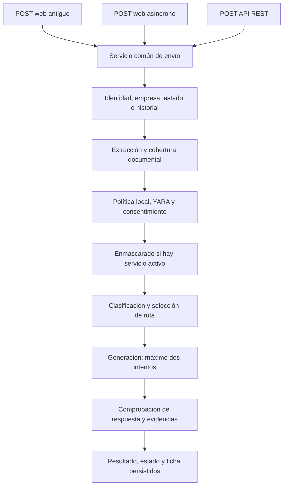

# regulAI Community: cambios respecto al repositorio original

**Fecha:** 3 de octubre de 2026. **Ámbito:** implementación y correcciones locales de Community, incluidos código, interfaz, migraciones, pruebas, operación y documentación.

Esta comparación utiliza tres referencias fijas. Así se distingue lo que ya existía en regulAI de las funciones añadidas y de los fallos corregidos durante su desarrollo.

| Referencia | Commit | Qué representa |
| --- | --- | --- |
| Repositorio original | `6a0f667c4fb02ec5a93b9eb9e2335385df7e2bda` | Punto de partida de todos los cambios descritos. |
| Primera implementación | `4400f0bb24defef5d3b8f0d10c391565511f52a2` | Inicio de la ronda de correcciones; su código coincide con `4b10778`. |
| Entrega comparada | `5a8579c31276b9a3c138238794e33b125d08e8c1` | Implementación, correcciones y evidencias integradas antes de crear este documento. |

El documento tiene dos niveles de lectura: [a grandes rasgos](#1-a-grandes-rasgos) y [explicación técnica](#2-explicación-técnica). Los resultados de pruebas se citan con su revisión y fecha; redactar esta comparación no supone haber repetido la suite. Los cambios permanecen locales: no se ha realizado push ni despliegue.

## 1. A grandes rasgos

### 1.1. Qué teníamos y qué tenemos ahora

El repositorio original ya permitía que usuarios de distintas empresas conversasen con varios proveedores de IA. Tenía usuarios, departamentos, permisos, conversaciones, reglas YARA, alertas, auditoría, claves cifradas, lectura de archivos e integración con un servicio de enmascarado. También permitía descargar archivos generados por la IA. Esas capacidades son anteriores a este trabajo.

El cambio principal es que ahora cada envío pasa por un recorrido común que decide qué puede salir, a qué destino, con qué límites y bajo qué condiciones. La aplicación conserva esa decisión y comprueba la respuesta antes de presentarla con el nivel de verificación que corresponda.

| Área | Repositorio original | Resultado de nuestro trabajo |
| --- | --- | --- |
| Envío desde web y API | Varias implementaciones con diferencias de validación y consentimiento. | Un mismo servicio aplica los controles a las tres entradas HTTP. |
| Fallos de seguridad | Algunas excepciones de validación podían dejar continuar el envío. | Si no se puede comprobar la autorización, el flujo se detiene. |
| Destinos externos | El generador y el enmascarador no compartían un control completo de salida. | Se comprueba cada destino externo, incluido Jev, el juez y el enmascarador. |
| Enmascarado | Ya existía una integración, pero no cubría de forma coherente todo el nuevo recorrido. | Con un servicio activo de la empresa, se protegen entrada, contexto, historial, fuentes y respuesta antes de enviarlos a los otros destinos. |
| Historial | Guardar un mensaje no dejaba constancia suficiente de si podía reutilizarse como contexto. | Solo se reutilizan turnos elegibles, de la misma empresa y propietario, dentro de límites explícitos. |
| Confirmación del usuario | La web recibía un indicador de confirmación; REST trataba las coincidencias de otra manera. | La confirmación queda firmada y ligada al contenido, la empresa, las reglas y los destinos concretos. |
| Doble envío o interrupción | No existía el nuevo estado persistido por identificador de petición. | Se reconoce una repetición y se conserva la incertidumbre si se pierde el resultado de una llamada. |
| Archivos | Extracción básica; la web recortaba a 10.000 caracteres el texto enviado al modelo. | Se informa qué se pudo leer; una extracción parcial impide responder como si se hubiera leído todo. |
| Clasificación | YARA aportaba reglas locales. | Se combina YARA con señales de Jev, sin permitir que Jev rebaje una prohibición local. |
| Elección del modelo | Selección de motores sin el nuevo catálogo de calidad, contexto y costes. | Se elige entre candidatos autorizados que cumplan capacidad, calidad configurada y presupuesto. |
| Respuesta y citas | No existía el nuevo contrato de afirmaciones y evidencias verificadas. | Se comprueban finalización, estructura, citas y, cuando corresponde, soporte semántico. |
| Segundo intento | No existía la cascada controlada añadida. | Puede haber una segunda generación, con motivos concretos, presupuesto y plazo; nunca una cadena ilimitada. |
| Explicación al usuario | La decisión estaba repartida entre mensajes, alertas y registros. | Una ficha muestra resultado, destino real, avisos, comprobaciones, llamadas y costes conocidos o desconocidos. |
| Configuración | Las credenciales y reglas no formaban una política de IA versionada. | Cada empresa tiene una política explícita, con borrador, comparación y activación separados. |
| Aislamiento | Existían empresas y roles, con controles incompletos en algunos recorridos. | Se refuerzan consultas, relaciones API, notificaciones, archivos y acceso a registros históricos. |
| Instalación y operación | Dos listas de dependencias divergentes y recursos de navegador externos. | Dependencias unificadas, recursos locales, registros sin contenido sensible y comprobaciones automatizadas. |
| Demostración y pruebas | Pruebas previas limitadas; no estaba el nuevo banco de evaluación. | Demo aislada, banco de 50 casos, 302 pruebas en la última ejecución conservada y evidencias de navegador. |

**Condición importante del enmascarado:** la aplicación utiliza las configuraciones de enmascarado activas de cada empresa. Si no hay ninguna, una política válida puede permitir enviar contenido sin transformar. El código no impone una obligación global de tener un enmascarador activo. Para que la decisión de enmascarar todo sea efectiva, hay que [configurar, autorizar y activar el servicio](arranque-y-demo.md#activar-el-enmascarado-de-la-empresa).

### 1.2. Un ejemplo de lo que cambia para el usuario

Supongamos que alguien adjunta un contrato sintético y pregunta por su plazo de preaviso. Antes, el modelo podía recibir solo los primeros 10.000 caracteres del archivo, sin una declaración estructurada del recorte. Esto no significa que YARA analizase únicamente esos caracteres: en ese recorrido recibía el texto extraído completo.

Ahora se determina primero si el contrato se ha podido leer. Si falta una parte textual necesaria, el envío se detiene. Si se ha leído el texto pero se han omitido imágenes, la aplicación lo declara y pide consentimiento para trabajar solo con el texto. Si las reglas lo clasifican como restringido, se bloquea incluso cuando el motor es privado.

Cuando la salida está autorizada, se selecciona un modelo admisible. Con enmascarado activo, los proveedores posteriores reciben las versiones transformadas. Una respuesta documental debe señalar los fragmentos que la respaldan; una cita inexistente, una salida cortada o una comprobación obligatoria fallida impiden presentarla como verificada. Si la política y el presupuesto lo permiten, puede intentarse una segunda generación.

La ficha permite ver lo que realmente sucedió: proveedor y modelo utilizados, límites del historial, avisos sobre el archivo, verificaciones y llamadas. No obliga al usuario a deducir estos datos a partir de una respuesta aparentemente convincente.

### 1.3. Qué está terminado y qué sigue pendiente

La implementación y la ronda de correcciones están integradas y revisadas. La última ejecución conservada pasó **302 pruebas**, las comprobaciones de Django y migraciones, el banco offline de **150 ejecuciones** y la auditoría de dependencias. El navegador se utilizó con proveedores sintéticos para comprobar consentimiento, evidencias, ficha y recarga.

Esto acredita controles locales y recorridos concretos. Quedan pendientes la calibración con ejemplos etiquetados por personas, la comparación real de calidad y ahorro, pruebas con documentos guardados en aplicaciones Office reales y el recorrido completo con proveedores vivos. No existe todavía una cifra de ahorro demostrada ni una garantía general de veracidad. El [estado de ejecución](estado-ejecucion.md) mantiene esos pendientes separados de las correcciones ya cerradas.

## 2. Explicación técnica

### 2.1. Arquitectura: un único servicio de envío dentro de Django

Se conservan Django, la API REST y los conectores existentes. La nueva coordinación está en [chat_service.py](../../regulai/front/chat_service.py), mediante `send_chat_message(actor, command)` y el resultado común `ChatResult`. Las vistas adaptan la petición HTTP y delegan; la política deja de estar implementada de forma distinta en cada entrada.

Se cubren el POST web antiguo de `/chat/`, el envío asíncrono de `/chat/send/` y `/api/chat/send/`, incluidas sus variantes de conversación. Las pruebas atraviesan estas entradas y comprueban el límite de red del proveedor, además de las funciones internas.



El diagrama resume el recorrido; cada salida externa vuelve a comprobar sus condiciones y registra la intención antes de llamar. Las funciones de política, documentos, clasificación, ruta y verificación tienen módulos separados. La integración permanece en la aplicación existente, sin añadir servicios distribuidos ni otro framework de proveedores.

### 2.2. Política explícita y cierre ante fallos

[policy.py](../../regulai/front/policy.py) introduce una configuración validada con Pydantic: tipos estrictos, rechazo de campos desconocidos y rechazo de valores no finitos. `PolicyDecision` distingue `allow`, `block`, `consent_required` y `unavailable`. La configuración tiene versión de formato y revisión para identificar exactamente qué política intervino.

El control local analiza el original antes de llamar al enmascarador. YARA inválida, una configuración ausente o reglas vacías sin autorización explícita impiden continuar. `allow_empty_rules` permite declarar conscientemente el último caso; no se interpreta una configuración incompleta como permiso. `ai_config={}` produce HTTP 503 y cero llamadas externas.

Los destinos se identifican de forma explícita, por ejemplo `engine:<id>`, `obfuscation:<id>` y `jev`. Se revalidan empresa, departamento, política, destinos y configuración del enmascarador antes de los efectos externos. La clasificación semántica puede restringir una decisión, pero no desactivar un bloqueo local. Las reglas se compilan sin `includes`, evitando que un texto YARA aportado por el usuario provoque lecturas de archivos por esa vía.

Las decisiones D1–D7 quedaron aprobadas por el usuario y se reflejan así:

| Decisión | Comportamiento acordado y condición actual |
| --- | --- |
| D1 | Multiempresa, registro público desactivado y política administrada en el ámbito de la empresa. |
| D2 | Enmascarar todo lo enviado a otros destinos, excepto lo que recibe el propio enmascarador. Requiere un servicio de la empresa configurado y activo; su ausencia no bloquea por sí sola. |
| D3 | La masa `unknown` se trata como `confidential`; la ambigüedad genera aviso por defecto. |
| D4 | `restricted` bloquea también hacia motores privados. |
| D5 | Inferir la empresa del `Prompt` histórico con marca reversible; mostrar `AuditLog` antiguo sin reescribir su contenido. |
| D6 | `complete_text_only` exige consentimiento cuando se omite contenido visual. |
| D7 | Seleccionar los últimos turnos elegibles que quepan en un presupuesto de bytes. |

El [encargo de correcciones](correcciones-community.md) conserva el detalle de estos acuerdos. La condición operativa de D2 está documentada expresamente para no confundir el acuerdo con una activación automática.

### 2.3. Persistencia, identidad e interrupciones

Se amplían las entidades de [models.py](../../regulai/front/models.py), que ya existían, para relacionar autorización, ejecución y mensajes.

| Entidad | Incorporaciones | Finalidad |
| --- | --- | --- |
| `Company` | `ai_config` y `jev_api_key` cifrada. | Política por empresa y credencial de Jev fuera del JSON. |
| `Prompt` | UUID `request_id`, empresa, estado, decisión JSON, mensaje de usuario enlazado y fecha de actualización. | Representar una ejecución y recuperar su resultado o incertidumbre. |
| `Prompt` | Restricción única `(user, request_id)`. | Evitar que el mismo usuario procese dos veces la misma identidad de petición. |
| `Prompt` | `historical_company_id`. | Marcar una inferencia histórica para poder revertirla sin borrar una reasignación posterior. |
| `Response` | Mensaje de asistente enlazado y evidencia JSON. | Asociar el texto presentado con sus comprobaciones y fragmentos. |
| `EngineModel` | Contexto, soporte JSON, reasoning, tarifas de entrada/salida, moneda y fecha. | Filtrar capacidades y estimar costes de forma explícita. |
| `AuditLog` | Empresa del evento. | Mantener su ámbito aunque después cambie el perfil del usuario. |

Repetir un `request_id` con el mismo contenido recupera el estado existente; reutilizarlo con otro contenido devuelve conflicto. La transición que reclama el procesamiento es condicional en base de datos. La unicidad y las transiciones controlan la concurrencia sin depender de un bloqueo de fila que SQLite no ofrece con `select_for_update()`.

Las llamadas de red ocurren fuera de transacciones largas. Una ejecución abandonada en `received` o `processing` puede convertirse en `outcome_unknown` tras 240 segundos y no se reenvía automáticamente. Si el proveedor procesó la petición pero se perdió su respuesta, no se deduce que el coste sea cero. Esta implementación no promete ejecución externa «exactamente una vez». Un cliente que omite el identificador obtiene uno nuevo y pierde la posibilidad de reconocer un duplicado por identidad.

### 2.4. Historial autorizado y consentimiento firmado

El historial requiere peticiones completadas del propietario y empresa actuales, mensajes enlazados con los roles correctos, elegibilidad persistida y un digest compatible con el contenido. Un mensaje antiguo, bloqueado o no verificado no adquiere permiso de reutilización por estar guardado.

La selección conserva pares completos de usuario y asistente, empezando por los más recientes. Los valores por defecto son **20 turnos y 32.768 bytes UTF-8**; se pueden configurar hasta 1.000 turnos y 1.048.576 bytes. La ficha declara las omisiones y el digest identifica el historial efectivamente seleccionado. También se comprueba la expansión que pueda introducir el enmascarador. Los turnos documentales no se reutilizan como si se conservara el archivo original: para volver a trabajar sobre él hay que adjuntarlo de nuevo.

El consentimiento utiliza una prueba firmada con caducidad de 300 segundos, vinculada a usuario, empresa, conversación, entrada, archivo, historial, política, reglas y destinos. Confirmar implica volver a validar ese conjunto. Un token caducado con firma válida puede renovarse manteniendo la petición y devolviendo un 409 con una razón como `consent_expired` o `consent_context_changed`. Una firma falsa no obtiene una renovación válida por esa vía.

Cancelar una petición pendiente no llama a proveedores. La cancelación de una petición nueva tampoco crea una conversación o un mensaje innecesarios. El consentimiento nunca levanta un bloqueo obligatorio. [Pruebas de estado](../../regulai/front/test_state.py) y [privacidad del flujo](../../regulai/front/test_pipeline_privacy.py) cubren estas condiciones y las entradas HTTP.

### 2.5. Enmascarado de todo el contexto utilizado

La integración externa de enmascarado ya existía. Se cambia su coordinación para que, cuando haya configuraciones activas de la empresa, trate de forma consistente petición, instrucciones de empresa y departamento, historial elegido, fragmentos y localizadores. La respuesta también se transforma antes del juez y de su reutilización autorizada en el historial.

`mask_texts` envía un array JSON serializado **dentro del campo `text: str`** de la petición al endpoint `/api/mask`. El servicio debe devolver `masked` como un string que contiene un array JSON de strings con la misma longitud y orden. Una respuesta incompatible detiene el flujo. El contrato por lotes mantiene la correspondencia entre segmentos; exige coherencia al servicio de enmascarado.

La autorización y el consentimiento preceden a esa llamada. El enmascarador recibe los originales porque necesita transformarlos, pero eso no lo exime de política, registro ni presupuesto. Si hay presupuesto configurado, `masking.max_call_cost` debe ser explícito; `"0"` es admisible para un servicio propio que realmente no tenga coste. Una cota ausente no se interpreta como gratuidad y bloquea antes de cualquier salida, también en simulación semántica.

Las citas se contrastan primero con las fuentes que realmente recibió el generador, antes de transformar la respuesta. Después se comprueban de nuevo. Esto evita que una cita inventada termine coincidiendo artificialmente porque dos valores distintos se hayan convertido en el mismo marcador de enmascarado.

La corrección B1 resolvió una regresión de la primera implementación. No debe atribuirse sin matices al repositorio original: el recorrido web original ya guardaba texto transformado tras un enmascarado correcto. El problema posterior fue extender y mantener esa protección a todos los segmentos, destinos y turnos del nuevo flujo.

### 2.6. Extracción documental: cobertura declarada y contenido fiel

Se introduce [documents.py](../../regulai/front/documents.py) y se amplía [file_security.py](../../regulai/front/file_security.py). La extracción deja de devolver únicamente texto y pasa a comunicar cobertura, fragmentos estables, localizadores y omisiones. El extractor tiene versión 2; texto largo se divide en bloques de hasta 40 líneas y las fuentes reciben identificadores estables.

| Estado | Interpretación y efecto |
| --- | --- |
| `complete` | Extracción textual admitida dentro del contrato del formato. |
| `complete_text_only` | Texto disponible, con elementos visuales o adjuntos omitidos que se declaran y requieren consentimiento. |
| `partial` | Se ha perdido contenido textual o hay una condición que impide asegurar la cobertura; detiene el envío. |
| `unreadable` | No se puede obtener una lectura utilizable; detiene el envío. |

Las omisiones se expresan en `disclosures`, con código, cantidad y localizadores. Los límites de carga son solo un primer filtro: un archivo menor puede rechazarse después por contexto, serialización, presupuesto o capacidad del juez.

| Formato | Cambios relevantes |
| --- | --- |
| Texto | UTF-8, UTF-16 con BOM y Windows-1252 declarado cuando corresponde. Los bytes indefinidos fallan; no se convierte cualquier binario en texto mediante un fallback permisivo. Se reconocen firmas binarias. |
| CSV | Coma, punto y coma, tabulador y barra vertical; lectura estricta del dialecto. Las filas irregulares solo se recuperan cuando hay una interpretación plausible única; en otro caso se declara cobertura parcial. |
| PDF | Extracción por páginas, distinción entre página en blanco y escaneada sin texto, y aviso por imágenes, imágenes inline, formularios o adjuntos omitidos. Los hipervínculos no vuelven parcial un documento por sí solos. |
| DOCX | Vista de cambios aceptados: incluye inserciones y excluye texto, filas y celdas eliminados. Lee texto de hipervínculos, evita instrucciones de campo, conserva numeración decimal multinivel y reinicios admitidos, y declara dibujos, contenido incrustado y formatos no soportados. |
| XLSX | Distingue expresión de fórmula y valor en caché: YARA ve la expresión y el generador recibe el valor disponible. Caché ausente o recálculo pendiente impiden declarar lectura completa. Conserva representación legible de números, fechas y porcentajes; no ejecuta fórmulas. |

Se sustituyen los intentos anteriores de OCR y envío visual por cobertura textual explícita. El campo de capacidad visual del catálogo puede seguir existiendo, pero este recorrido documental no ofrece OCR ni análisis de imágenes. Las [pruebas documentales](../../regulai/front/test_documents.py) y de [fidelidad](../../regulai/front/test_document_fidelity.py) usan documentos sintéticos; la validación con archivos guardados desde Word, Excel y LibreOffice reales queda pendiente.

### 2.7. Límites de recursos y tiempos

El parseo documental se ejecuta en un subproceso con tiempo máximo. Se limita tanto el archivo de entrada como su expansión interna para evitar que una carga pequeña consuma recursos desproporcionados.

| Recurso | Límite actual |
| --- | --- |
| Texto y CSV | 1 MiB de entrada. |
| PDF, DOCX y XLSX | 10 MiB de entrada. |
| Texto y unidades extraídas | 200.000 caracteres y 10.000 unidades. |
| PDF | 100 páginas; expansión Flate acumulada de 32 MiB; LZW no admitido. |
| ZIP de formatos Office | 32 MiB expandidos, 2.000 entradas y ratio máximo de 100. |
| XLSX | 100 hojas, 256 columnas y 100.000 celdas/cadenas. |
| XML | 100.000 elementos y profundidad 128. |
| Parser | 5 segundos por defecto; `DOCUMENT_PARSER_TIMEOUT` configurable. |
| Jev | Estado de 98.304 bytes UTF-8, envoltura completa de 196.608 bytes, hasta 32 preguntas y respuesta HTTP de 65.536 bytes por defecto. |
| Salida generada | `routing.max_output_tokens`: 1.000 por defecto, máximo configurable de 32.000, sujeto a la capacidad del candidato. |
| Respuesta aceptada localmente | `min(128000, max_output_tokens × 8)` bytes UTF-8; es una cota de aceptación, no una equivalencia formal entre tokens y bytes. |
| Tiempo de llamada/petición | 30/90 segundos por defecto; plazo total máximo de 180 segundos. |

El tiempo restante limita cada llamada. Jev tiene además un máximo de 120 segundos, dividido entre conexión y lectura, cada una acotada a 60 segundos. Los SDK tienen `max_retries=0`: la aplicación conserva el control de los intentos. Los límites detallados están vinculados al código en el [informe de correcciones](informe-correcciones-community.md#cobertura-y-límites-efectivos).

### 2.8. Clasificación conservadora y contrato Jev

[jev.py](../../regulai/front/jev.py) encapsula el contrato con TypeSafe/Jev y su acceso por Vercel Gateway. Los endpoints, proveedor y formato de versión se validan; las claves se conservan cifradas fuera de `ai_config`. Se rechazan redirecciones, respuestas fuera de límites y distribuciones incoherentes.

[classification.py](../../regulai/front/classification.py) interpreta probabilidades finitas entre 0 y 1, suma aproximadamente uno, categoría seleccionada máxima y confianza compatible con su probabilidad. Una confianza inferior al máximo no se considera automáticamente un error: por ejemplo, 0,49 frente a una categoría de 0,59 puede ser un resultado válido pero incierto.

La sensibilidad sigue el orden `public`, `internal`, `confidential`, `restricted`. La masa `unknown` se suma al nivel configurado, `confidential` por defecto. Se selecciona un nivel cuyo riesgo acumulado en categorías superiores no exceda el margen permitido; con umbral 0,8, ese margen es 0,2. Después se aplica el máximo entre esa estimación y el mínimo obligatorio local.

Las señales específicas tienen otra función: `credentials` desde 0,2 eleva a restringido; datos personales o de negocio desde 0,2 elevan a confidencial; manipulación desde 0,2 detiene con `classification_manipulation`. Este umbral de señal no sustituye ni reduce el umbral 0,8 de las comprobaciones de verificación.

La ambigüedad y la falta de evidencia generan avisos por defecto, con instrucciones efectivas al generador para pedir aclaración cuando corresponda; se puede configurar su detención. La incertidumbre de tarea conserva las tareas plausibles y sus mínimos de calidad, incluso si solo queda una. Chat y simulador utilizan la misma interpretación conservadora. No se presenta la confianza de Jev como una probabilidad de que la respuesta final sea verdadera.

### 2.9. Selección de modelos, costes y segundo intento

[routing.py](../../regulai/front/routing.py) selecciona entre candidatos previamente autorizados. Filtra capacidad de contexto y salida, soporte requerido, calidad configurada por tarea y presupuesto. Entre los admisibles utiliza el menor coste estimado, con desempate determinista. La calidad procede de configuración externa: el modelo no se asigna a sí mismo una nota para conseguir la ruta.

Las tarifas son **USD por millón de tokens** y los cálculos usan `Decimal`:

```text
coste estimado = (tokens de entrada × tarifa de entrada
                 + tokens de salida × tarifa de salida) / 1.000.000
```

Un precio ausente significa desconocido; un cero explícito significa gratuito. Los validadores rechazan valores positivos inferiores a 0,0001 en esos campos para detectar una confusión probable con tarifas por token. La aplicación no convierte monedas ni multiplica automáticamente los precios antiguos, porque no puede inferir la unidad con que se introdujeron. `price_date` registra la fecha, pero no actualiza las tarifas ni las hace caducar automáticamente.

La estimación de entrada utiliza bytes UTF-8 y sobrecarga, no un tokenizador exacto de cada proveedor. Se cuenta la envoltura pública de Anthropic; la sobrecarga interna no publicada sigue siendo una hipótesis del estimador. La ficha distingue estimación, coste comunicado y partidas desconocidas. Se reserva capacidad económica para las comprobaciones obligatorias, el enmascarado activo y, si procede, el segundo intento.

El usuario puede elegir ruta automática o motor manual. En modo manual, el segundo intento se mantiene en ese motor salvo autorización explícita para cambiarlo. Hay un máximo de dos generaciones, un presupuesto por petición y un plazo total. El segundo intento recibe la respuesta anterior y los controles concretos fallidos, con roles válidos; un error de transporte no se transforma en una supuesta crítica de calidad. Una llamada de resultado incierto no se repite automáticamente.

El presupuesto de una petición no equivale a una cuota económica global por organización. El ledger persistente de las pruebas reales es específico de `smoke_ai`; no constituye ese sistema de cuotas del producto.

### 2.10. Respuestas documentales, citas y juez

[sources.py](../../regulai/front/sources.py) entrega al generador alias cortos, como `S1`, junto con texto y localizador. El identificador estable basado en hash queda en el servidor y permite resolver la evidencia sin obligar al modelo a reproducirlo.

Una respuesta documental utiliza este contrato:

```json
{
  "claims": [
    {
      "text": "El plazo de preaviso es de 17 días.",
      "citations": [
        {"id": "S1", "quote": "El plazo de preaviso será de 17 días."}
      ]
    }
  ]
}
```

[verification.py](../../regulai/front/verification.py) rechaza claves extra o duplicadas, alias inexistentes y extractos que no aparecen en la fuente enviada. Acepta una única envoltura de bloque de código JSON; no relaja por ello el esquema interno. Admite hasta 30 afirmaciones de hasta 4.000 caracteres, cada una con 1–8 citas. Cada extracto tiene un máximo de 1.600 caracteres y debe alcanzar 12 caracteres sin espacios o tres palabras, siempre con más de un carácter no blanco. Los extractos acumulados tienen un límite de 16.000 caracteres.

La evidencia conserva el índice de afirmación empezando en 1, alias, identificador de fragmento, localizador del servidor y extracto resuelto. Una ruta o URL inventada por el modelo no se convierte en una fuente autorizada. Se normaliza `finish_reason`: una salida por límite de longitud falla completitud, y `None` no se presume finalización correcta sin otra evidencia reconocida.

La existencia literal de una cita no demuestra que respalde la afirmación. El juez semántico comprueba soporte, contradicción y omisiones cuando el modo lo exige. Los modos de verificación distinguen comprobación local, `advisory` y `enforce`; el recorrido documental requiere la comprobación semántica correspondiente. En `advisory`, una salida que supera las comprobaciones locales pero no la verificación exigida puede mostrarse como prosa **No verificado**, sin evidencia presentada como validada y sin elegibilidad de historial.

Antes de generar se calcula una cota del estado que necesitará el juez: contexto serializado, expansión JSON de la salida aceptada, hasta 30 × 8 localizadores/citas, estructura y preguntas. Si no cabe, se rechaza con `evaluation_input_too_large` antes de gastar en generación. No se intenta arreglar después mediante un recorte silencioso. El juez recibe las afirmaciones y extractos resueltos, y las fuentes/contexto que corresponden al recorrido, sin un muestreo que oculte partes para hacerlo caber.

### 2.11. Conectores y registro de cada llamada

Se amplía [connectors.py](../../regulai/front/connectors.py), reutilizando OpenAI, Anthropic y OpenAI compatible. El resultado incorpora uso de entrada/salida e identificador de respuesta, además del texto y motivo de finalización ya disponibles. Se desactivan reintentos ocultos y redirecciones, y se aplican tiempos máximos explícitos.

El soporte de JSON y de modelos con reasoning se declara en el catálogo. La petición utiliza el contrato que corresponde al conector y a esas capacidades; no se deducen capacidades por una coincidencia informal del nombre. Anthropic conserva conjuntamente las instrucciones de empresa y departamento, en lugar de reemplazar unas por otras, y utiliza su formato de salida estructurada cuando procede.

Antes del efecto externo se registra la intención; después se anota resultado, destino, duración, uso y coste disponible. La autorización se comprueba también para Jev y el enmascarador. Los fallos de la propia aplicación se distinguen de los del proveedor y no se presentan todos como el mismo problema de red.

### 2.12. Aislamiento entre empresas, permisos y archivos

[access.py](../../regulai/front/access.py) concentra la resolución de empresa y conversaciones autorizadas. Se revisan consultas de vistas y API, junto con las relaciones aceptadas por [serializers.py](../../regulai/api/serializers.py): motores, usuarios, departamentos y grupos no se pueden vincular libremente a objetos de otra empresa. Los campos de registros que representan ejecución o auditoría pasan a ser de solo lectura donde corresponde; resolver una alerta utiliza una acción explícita.

Las notificaciones se filtran por empresa y rol autorizado. El acceso global a la administración Django y al catálogo requiere usuario activo, `staff`, `superuser` y pertenencia explícita a `PLATFORM_ADMIN_USER_IDS`. El administrador de empresa puede gestionar su política sin recibir esas facultades globales. Ese permiso no le concede automáticamente acceso a la sección de seguridad del enmascarado, que mantiene sus requisitos propios.

Las operaciones de cambio de estado, como alternar el enmascarado, resolver o reabrir alertas y modificar reglas o motores, se sirven mediante POST con protección CSRF en la web. Un GET no ejecuta esas mutaciones. Las descargas de conversación comprueban propietario y empresa; se elimina la publicación genérica de `MEDIA_ROOT` incluso con `DEBUG`.

Los avatares utilizan validación común de contenido real de imagen en web y API y una ruta autenticada dentro de la empresa. Las respuestas privadas incorporan controles como `private`, `no-store` y `nosniff` según el endpoint. El limitador de envíos cuenta los POST; abrir páginas mediante GET deja de consumir esa cuota.

También se corrigió un caso histórico: si un usuario cambiaba de empresa, su departamento actual podía aparecer en listados de `Prompt` o `Alert` de la empresa anterior. La presentación y el filtrado exigen ahora que las relaciones de perfil, departamento y empresa sean compatibles con el registro consultado. Se conserva el departamento legítimo, pero no se expone el ajeno. Véanse las [pruebas de permisos API](../../regulai/api/test_permissions.py), de [seguridad backend](../../regulai/front/test_backend_hardening.py) y de [departamentos históricos](../../regulai/front/test_history_departments.py).

### 2.13. Claves, recifrado y registros sin contenido sensible

Las credenciales ya estaban cifradas en el original. [encryption.py](../../regulai/front/encryption.py) añade un anillo `MultiFernet`: la clave principal cifra las escrituras nuevas y las anteriores admitidas permiten descifrar durante una transición. Los errores no muestran el secreto que no se pudo leer.

[checks.py](../../regulai/front/checks.py) detecta claves públicas históricas de las plantillas mediante `front.E001`. El procedimiento distingue claves de cifrado y claves de firma de Django; una clave de firma comprometida no debe mantenerse activa como fallback de sesiones o consentimientos. La recuperación de cifrados antiguos con material histórico se acota a mantenimiento offline.

El comando [reencrypt_secrets](../../regulai/front/management/commands/reencrypt_secrets.py) ofrece `dry-run`, lotes configurables y actualización condicional para detectar cambios concurrentes. El recifrado queda dentro de una transacción: un cifrado inválido o un conflicto no dejan una rotación parcialmente aplicada. La [guía de rotación](rotacion-claves.md) documenta copia, mantenimiento, recuperación, recifrado y comprobaciones. Las pruebas utilizan bases aisladas; no se ha rotado la base del usuario.

[safe_logging.py](../../regulai/front/safe_logging.py) limita los campos registrados a metadatos admitidos, como fecha, nivel, logger, identificador de petición, código y tipo de excepción. Evita incorporar mensajes de excepción, argumentos, texto de conversación, documentos, tokens o variables locales. El middleware de auditoría usa el patrón de ruta, no la URL completa con parámetros potencialmente sensibles, y conserva el ámbito de empresa.

### 2.14. Migraciones y tratamiento de datos antiguos

Se incorporan seis migraciones sobre la última del original, `0025`. El esquema evoluciona ampliando los modelos existentes.

| Migración | Cambio y conservación de datos |
| --- | --- |
| [0026](../../regulai/front/migrations/0026_authorized_chat_state.py) | Política y estado autorizado. El UUID se añade primero como nullable, se asigna uno por registro y luego se exige y restringe. Los registros previos quedan `legacy`, sin convertirlos en historial autorizado. |
| [0027](../../regulai/front/migrations/0027_enginemodel_context_window_enginemodel_currency_and_more.py) | Añade capacidades de contexto/JSON y datos de tarifas del catálogo. |
| [0028](../../regulai/front/migrations/0028_auditlog_company.py) | Añade empresa al evento de auditoría para registrar procedencia en adelante. |
| [0029](../../regulai/front/migrations/0029_model_price_units.py) | Explicita USD por millón y validadores. No reescala valores anteriores suponiendo una unidad que no consta. |
| [0030](../../regulai/front/migrations/0030_enginemodel_reasoning.py) | Añade `reasoning` con valor inicial falso. |
| [0031](../../regulai/front/migrations/0031_infer_historical_prompt_company.py) | Infiere la empresa de `Prompt` con empresa nula a partir del perfil y guarda la marca `historical_company_id`. |

La 0031 procesa lotes de 1.000 mediante claves ordenadas y actualizaciones por lote. Su reversión solo limpia la empresa cuando todavía coincide con la marca inferida; respeta una reasignación explícita posterior. No debe extenderse esa descripción a todas las migraciones: la inicialización de UUID de 0026 tiene su propio procedimiento por registro.

Para `AuditLog` antiguo sin empresa se permite una visualización histórica de solo lectura, inferida a partir del perfil actual y marcada como tal. No se reescribe el contenido auditado ni se presenta esa inferencia como prueba de la empresa real en la fecha del evento. Las operaciones de borrado o limpieza no incluyen esos registros históricos por esa vía.

Las pruebas cubren conservación y reversión sobre bases de desarrollo/test aisladas. Eso no equivale a haber migrado datos del usuario ni una base de producción.

### 2.15. Arranque y simulador de políticas

`ALLOW_REGISTRATION=False` deja desactivado el registro público por defecto. El alta inicial ya no otorga facultades globales de `staff/superuser` como consecuencia automática del primer usuario. La política se administra dentro de la empresa.

[bootstrap_ai_policy](../../regulai/front/management/commands/bootstrap_ai_policy.py) crea un borrador con motores activos de esa empresa y avisos sobre datos incompletos. **Siempre imprime un borrador; omitir `--dry-run` tampoco lo activa.** No inventa calidad, precios o capacidades, ni autoriza Jev implícitamente. El borrador utiliza suelo local `internal`; la categoría desconocida sigue tratándose como `confidential`.

[policy_simulator.py](../../regulai/front/policy_simulator.py) compara una propuesta frente a la política y reglas vigentes. El modo local usa señales sintéticas explícitas y no llama a proveedores. El semántico requiere autorización, consentimiento, presupuesto y los mismos controles previos sobre Jev y el enmascarador activo.

Activar es un POST separado con una prueba firmada ligada al contenido, revisión y caducidad de la comparación. Un cambio concurrente obliga a comparar de nuevo. La auditoría guarda configuración y reglas anteriores y nuevas, sin la muestra enviada ni las credenciales. Para recuperar una política anterior se compara y activa una nueva revisión con esos datos; no hay una restauración automática de todo el sistema.

El simulador cubre muestra, política y ruta; no reproduce por completo documentos, historial y todos los intentos de una conversación. La [guía de arranque](arranque-y-demo.md) explica completar catálogo, revisar permisos y activar el resultado.

### 2.16. Interfaz, ficha y recursos del navegador

El [chat](../../regulai/front/templates/chat/chat.html) incorpora selección automática, estados de envío, renovación del consentimiento, cancelación, avisos de cobertura, respuesta no verificada y evidencia desplegable. Se conserva lo necesario para continuar una confirmación sin perder la selección o el archivo. Se elimina JavaScript de modales que ya no participa en el recorrido.

La ficha pública se construye desde una lista de campos permitidos en [chat_ui.py](../../regulai/front/chat_ui.py). Muestra el motor y modelo reales, aunque dos motores compartan nombre de modelo, y conserva límites y omisiones después de recargar o exportar. Los endpoints verifican propietario y empresa y no exponen claves, tokens firmados ni metadatos internos arbitrarios.

El contenido dinámico se inserta como texto o con escape. La generación del identificador de petición tiene un fallback UUID v4 mediante `crypto.getRandomValues` cuando `crypto.randomUUID` no está disponible, como puede suceder al usar HTTP en una intranet; no recurre a `Math.random`.

Se incorporan siete recursos vendor locales con [manifiesto de hashes](../../regulai/static/vendor/manifest.json): Bootstrap, jQuery, Chart.js, Iconify, estilos Simplebar y los catálogos de iconos utilizados. Chart.js queda en 4.5.1; Iconify tiene desactivada la consulta externa de iconos y se usan fuentes del sistema en lugar de cargar Google Fonts. `.gitattributes` conserva los bytes de esos archivos en Windows. La prueba correspondiente clona un fixture de recursos, no todo el repositorio.

La política CSP se incorpora en modo **Report-Only**, por lo que no se debe afirmar que bloquea cargas. Las comprobaciones de JavaScript/DOM en Node y las [capturas de navegador offline](../../evals/reports/ui-community-fixes-20261003/README.md) son evidencias distintas. El navegador confirmó, entre otros recorridos, abrir citas con teclado, consentir cobertura textual y recuperar la ficha persistida.

### 2.17. Dependencias y configuración reproducible

La [lista raíz de dependencias](../../requirements.txt) pasa a ser la única fuente con 45 versiones fijadas. La [lista interior](../../regulai/requirements.txt) la incluye mediante `-r ../requirements.txt`, eliminando diferencias como la antigua combinación de `docx` y `python-docx`.

| Componente | Original, archivo raíz | Entrega comparada |
| --- | --- | --- |
| Django | 4.2.28 | 5.2.17 |
| Django REST Framework | 3.15.2 | 3.18.1 |
| SimpleJWT | 5.4.0 | 5.5.1 |
| cryptography | 46.0.5 | 50.0.0 |
| lxml | 6.0.2 | 6.1.0 |
| Pillow | 11.3.0 | 12.3.0 |
| PyJWT | 2.11.0 | 2.15.0 |
| PDF | PyPDF2 3.0.1 | pypdf 6.19.0 |
| requests | 2.32.5 | 2.33.0 |
| urllib3 | 2.6.3 | 2.8.0 |
| sqlparse | 0.5.3 | 0.6.0 |
| anyio | 4.10.0 | 4.14.2 |
| idna | 3.10 | 3.15 |
| python-dotenv | 1.1.1 | 1.2.2 |

Se conserva el stack de conectores, con OpenAI 1.102.0 y Anthropic 0.79.0. La instalación se comprobó con Python 3.12.11. El [registro de dependencias](dependencias-verificadas.md) documenta el resultado histórico de auditoría: 96 avisos en 12 paquetes al inicio y ninguno conocido tras actualizar. Es una observación fechada sobre las versiones analizadas.

[bootstrap_local.py](../../scripts/bootstrap_local.py) crea la configuración local solo si no existe, usando creación exclusiva para no sobrescribir secretos. Genera claves nuevas y ajusta permisos privados; en Windows el ajuste de ACL es de mejor esfuerzo y avisa si no puede completarse. Se añaden configuraciones separadas de test y demo, sin utilizar las bases del usuario para las pruebas automatizadas.

### 2.18. Operación, CI y demo aislada

La configuración de [Gunicorn](../../gunicorn.conf.py) usa `gthread`, cuatro hilos, `timeout` y `graceful_timeout` de 240 segundos, por encima del plazo máximo de 180 del flujo. Desactiva el access log genérico e integra el formateador seguro. Se ha probado su configuración; no se ha arrancado Gunicorn en Windows.

El [workflow de CI](../../.github/workflows/ci.yml) declara cinco puertas: Django check, suite `front api`, detección de cambios de migración, evaluación offline y auditoría de dependencias. Usa Python 3.12, Node 22, `uv 0.12.3` y `pip-audit 2.10.1`; el checkout incluye historial. Las pruebas locales verifican esta configuración, pero no se ha ejecutado GitHub Actions remoto ni PostgreSQL.

[run_demo](../../regulai/front/management/commands/run_demo.py) crea un entorno con base, medios y cookies separados, datos sintéticos y proveedores simulados. El servidor bloquea salidas de red en ese proceso. La carga de datos es repetible y se niega a sobrescribir registros que hayan cambiado de forma incompatible. La interfaz identifica la demo; los recursos locales permiten el recorrido de navegador sin depender de sus CDN anteriores.

[smoke_ai](../../regulai/front/management/commands/smoke_ai.py) y [evaluation_budget.py](../../regulai/front/evaluation_budget.py) añaden ensayos reales acotados con reserva persistente antes de la llamada. Los resultados inciertos conservan su reserva. Ese comando mantiene una autorización temporal explícita del 2 de octubre de 2026; la comparación presente no la renueva ni autoriza gasto.

Se conservan evidencias históricas de una petición sencilla a DeepSeek, clasificación Jev y dos juicios sobre respuestas redactadas previamente. La prueba `jev_verification_component` utilizó un script no versionado: su resultado no es una prueba reproducible del recorrido documental completo. Durante la ronda de correcciones y la redacción de este documento no se hicieron nuevas llamadas pagadas.

### 2.19. Pruebas, banco offline y resultado conservado

Se añaden pruebas de permisos, estado, concurrencia, consentimiento, límites, documentos, red de proveedores, costes, migraciones, interfaz y operación. También se corrige una expectativa de la suite original: `validate_prompt` devuelve coincidencias; la creación de alertas se comprueba desde el envío HTTP que debe producirlas.

[evaluate_ai](../../regulai/front/management/commands/evaluate_ai.py) ejecuta 50 casos sintéticos: 30 de desarrollo y 20 reservados, cada uno con `economy`, `strong` y `router`. Son **150 ejecuciones** del servicio con respuestas, juicios y uso prefijados, SQLite en memoria y red bloqueada. Conserva cinco salidas: informe Markdown, resumen JSON, resumen CSV, resultados JSONL y manifiesto. Rechaza sobrescribir una ejecución previa.

El comando devuelve error si fallan controles, después de guardar los informes. Una prueba negativa confirmó 52 controles fallidos en 90 ejecuciones de desarrollo, cero casos reservados y salida 1. Otra prueba negativa de la suite fuerza seis fallos. Son controles deliberados del evaluador; no son fallos ocultos del banco final. Solo tres etiquetas de desarrollo se ajustaron por D3, con [justificación por caso](cambios-banco-correcciones.md); no se modificó el conjunto reservado para conseguir aprobación.

La ejecución más reciente conservada corresponde a `52bdc8d71d37dcf40b59293346a4f74f043ef416`, después de integrar la documentación de correcciones. Los commits posteriores hasta `5a8579c` archivaron evidencias y cerraron documentación sin alterar el código funcional probado.

| Comprobación | Resultado conservado el 3 de octubre de 2026 |
| --- | --- |
| Django check | Sin incidencias. |
| Suite `front api` | **302 pruebas, 62,428 segundos, OK**, sin omisiones ni `expectedFailure`. |
| `makemigrations --check --dry-run` | Sin cambios detectados. |
| Evaluación offline | **150 ejecuciones, cero controles fallidos, cero llamadas reales.** |
| Auditoría de dependencias | Sin vulnerabilidades conocidas en ese análisis. |

Los [logs, comandos y hashes](../../evals/reports/community-fixes-docs-verification-20261003/README.md) permiten identificar lo ejecutado. Las 129 pruebas del 2 de octubre pertenecen a una implementación intermedia; no son el número de pruebas del repositorio original ni de la entrega actual.

El banco confirma comportamiento de controles frente a resultados programados. No mide precisión semántica, ahorro real o calidad comparativa de los modelos. `evaluate_ai --real` sigue desactivado y su conexión al ledger de pruebas reales está pendiente.

### 2.20. Correcciones de la primera implementación: B1–B10 y C1–C2

Estas doce incidencias se reprodujeron contra `4400f0b`, no contra el repositorio original `6a0f667`. Las doce pruebas fallaron por aserciones de comportamiento, sin errores de preparación ni omisiones, y pasan tras la integración. La [evidencia de regresiones](../../evals/reports/community-fixes-verification-20261003/regressions.json) y [ReviewRegressionTests](../../regulai/front/test_review_regressions.py) conservan esa correspondencia.

| Incidencia | Corrección incorporada |
| --- | --- |
| B1. Historial y Jev podían recibir contenido en claro. | Con máscaras activas, se transforma cada segmento autorizado y cada turno que sale a los demás destinos. |
| B2. Notificaciones de alertas ajenas. | Se filtran por empresa y rol autorizado. |
| B3. Coste del enmascarador sin cota. | Bajo presupuesto, la ausencia de cota explícita bloquea antes de cualquier llamada externa. |
| B4. Citas incompatibles con fuentes enmascaradas. | Se resuelven contra las fuentes realmente enviadas y se evita validar una cita inventada mediante una transformación posterior. |
| B5. JSON visible en modo advisory. | Se muestra prosa legible con etiqueta No verificado, sin evidencia validada ni elegibilidad de historial. |
| B6. Juez demasiado grande detectado después de generar. | Se calcula la cota del peor estado antes de la generación. |
| B7. Word mezclaba texto borrado y aceptado. | Se usa la vista de cambios aceptados y se declaran las condiciones de extracción. |
| B8. Bloque JSON único rechazado. | Se permite una sola envoltura JSON, manteniendo el parser estricto. |
| B9. Consentimiento caducado sin continuación válida. | Se emite prueba nueva para una petición y contexto admisibles; una firma falsa no se renueva. |
| B10. HTTP sin `crypto.randomUUID`. | Se genera un UUID v4 mediante `crypto.getRandomValues`; se prueba el JavaScript servido por Django. |
| C1. Incertidumbre de categoría detenía el recorrido por defecto. | Se interpreta toda la distribución conservadoramente y se declara aviso conforme a D3. |
| C2. Señal `credentials=0,75` ignorada. | La señal desde 0,2 eleva a restringido y bloquea la generación. |

### 2.21. Hallazgos adicionales de revisión y su cierre

La revisión posterior encontró problemas que no estaban cubiertos por las doce regresiones iniciales. Se añadieron pruebas que reprodujeron los fallos antes de integrar las correcciones.

| Área | Hallazgo y resolución |
| --- | --- |
| Política y privacidad | Una reclasificación podía continuar sin juez o máscara obligatorios. Se revalidan las necesidades, la identidad/configuración del enmascarador y el mínimo local para `unknown` antes de continuar. |
| Documentos | Se añaden avisos por imágenes PDF inline, exclusión de filas Word eliminadas, interpretación estricta de CSV irregular y semántica de reinicio decimal. |
| Clasificación | Se conserva el mínimo de calidad cuando solo hay una tarea plausible y los avisos generan instrucciones efectivas de aclaración. |
| Seguridad | El interruptor de enmascarado deja de mutar mediante GET; se comprueban POST, CSRF y empresa. |
| Interfaz | La recarga y exportación conservan límites del historial; la ficha identifica el motor real además del nombre del modelo. |
| Histórico | Se evita mostrar o filtrar por el departamento de otra empresa después del traslado de un usuario. |
| Evaluación | La CLI devuelve salida no cero si fallan controles y conserva los cinco informes para diagnosticarlo. |
| Documentación | Se aclaran las unidades de precio, el procedimiento de recuperación de claves y la necesidad de tener un enmascarador activo. |

Los informes [Standards y Spec](revisiones-correcciones/README.md) mantienen sus revisiones y manifiestos originales. No se reescriben como si hubieran analizado un commit posterior. El [informe de correcciones](informe-correcciones-community.md) enlaza las pruebas, reproducciones y commits concretos por hallazgo, incluida la verificación independiente de la aclaración documental de D2.

### 2.22. Qué cambia al actualizar una instalación existente

Hay cambios de comportamiento deliberados que conviene identificar antes de utilizar la entrega sobre una instalación del original.

| Cambio | Consecuencia operativa |
| --- | --- |
| Política vacía deja de permitir el arranque del chat. | Las credenciales guardadas no bastan: se debe completar, comparar y activar una política. |
| Registro público cerrado por defecto. | El alta debe seguir el procedimiento elegido por la organización. |
| Permisos globales explícitos. | Un administrador de empresa no adquiere acceso general al catálogo o a la administración Django. |
| UUID de petición y consentimiento firmado. | Clientes web/API deben conservar identidad y prueba durante confirmación o repetición; un booleano no sustituye el nuevo contrato. Los ejemplos API se han actualizado. |
| Contrato estructurado del enmascarador. | El servicio debe aceptar el lote serializado y devolver exactamente la estructura exigida. Hay que configurarlo y activarlo para aplicar D2. |
| Capacidad, calidad y precios declarados. | Los datos faltantes pueden excluir una ruta; las tarifas deben revisarse en USD por millón. |
| Historial antiguo sin autorización nueva. | Sigue conservado para consulta permitida, pero no se incorpora automáticamente al contexto de proveedores. |
| Cobertura documental estricta. | Ciertos archivos antes aceptados de forma aproximada ahora se bloquean o exigen consentimiento por omisiones. |
| OCR y visión fuera del nuevo recorrido. | Un PDF escaneado sin texto no se trata como documento completamente leído. |
| Medios privados y mutaciones POST. | Los clientes deben usar los endpoints autorizados y el método/protección correspondiente. |
| Claves históricas públicas rechazadas. | La instalación debe seguir el procedimiento de claves antes de iniciar el servicio con esos valores. |
| Seis migraciones añadidas. | Se requiere el procedimiento normal de copia, migración y verificación del entorno de destino. Las pruebas realizadas fueron sobre bases aisladas. |

Estas condiciones y sus comandos de arranque se desarrollan en [arranque y demo](arranque-y-demo.md), [ejemplos API](../../regulai/api/api_examples.sh) y [rotación de claves](rotacion-claves.md).

### 2.23. Documentación y organización del trabajo incorporadas

Además del código se añadieron los doce planes de implementación, tareas locales desde la preparación hasta la revisión final, guías de arranque y demo, snapshot del contrato Jev, registro de dependencias, procedimiento de claves e informes técnicos. Las tareas viven en `docs/plan-blackhat/tareas/`; no se abrió un gestor remoto de incidencias para este trabajo.

`AGENTS.md` y [docs/agents](../agents/domain.md) fijan el ámbito de la aplicación, las decisiones autorizadas y el uso del tracker local. Se incorporaron skills de trabajo con origen/versiones y licencia documentados; no son componentes que el producto necesite en ejecución. El [método](metodo-matt-pocock.md) explica su adaptación a Django. El vocabulario común permanece en el [README del plan](README.md#vocabulario-que-utilizaremos).

Los informes de ejecución, banco y navegador incluyen manifiestos y hashes para identificar qué versión se comprobó. Esta comparación los conecta con el resultado final, agrupando cambios por comportamiento. El diff de Git sigue siendo el inventario exhaustivo de archivos y líneas.

### 2.24. Límites de la entrega y trabajo que no se ha realizado

| Pendiente o límite | Situación real |
| --- | --- |
| Calidad, sensibilidad y juez | Faltan etiquetas humanas representativas y calibración; los umbrales no se han rebajado para hacer pasar la demo. |
| Ahorro, coste y latencia comparativos | El selector calcula y limita costes, pero no hay un estudio real que demuestre ahorro manteniendo calidad. |
| Banco completo con proveedores reales | `evaluate_ai --real` está desactivado; falta conectarlo a ejecución, presupuesto y manifiesto reales. |
| Recorrido documental real completo | Las pruebas de componentes históricas no lo sustituyen. Requiere autorización y tarifas revisadas. |
| Office real | Faltan casos sintéticos guardados desde Word, Excel y LibreOffice reales. |
| Ensayos con personas | Quedan dos ensayos de la demo con otra persona y registro de resultados. |
| Infraestructura de destino | No se han ejecutado PostgreSQL, CI remoto, Gunicorn en Windows ni despliegue. |
| Datos y claves del usuario | No se han migrado ni rotado; la evidencia corresponde a bases aisladas. |
| Enmascarado obligatorio global | No hay un bloqueo automático por carecer de servicio activo; requiere configuración operativa para cumplir D2. |
| Capacidades fuera de alcance | No se añadió ofuscación inteligente reversible, RAG persistente, base vectorial, OCR, análisis visual ni cuotas económicas globales por organización. |

La revisión técnica local está cerrada con estos límites explícitos. Una preparación posterior para piloto deberá atender los pendientes aplicables al entorno y a los datos elegidos; este documento no presenta una certificación de seguridad ni una garantía universal de exactitud.

### 2.25. Referencias de Git y reproducción de la comparación

Los hitos siguientes ayudan a localizar las áreas principales. La tabla no sustituye la historia completa: algunos bloques se refinaron en varios commits posteriores.

| Hito | Commits de referencia |
| --- | --- |
| Preparación y dependencias | `18ecca7`, `75ec867`, `b99434a`. |
| Extracción, Jev, ruta, verificación y estado inicial | `853d495`, `48a25e8`, `2a5bd40`. |
| Recursos locales e integración del servicio común | `023c7ef`, `bbb86a5`. |
| Ensayos acotados, evaluación y demo | `6496ef7`, `cfa29fa`, `4b10778`. |
| Inicio de correcciones | `4400f0b`. |
| Privacidad, historial, prevalidación del juez e integración | `e49cc6e`, `35f8ff0`, `e657410`, `eb8fde7`. |
| Clasificación y primera corrección de fidelidad Word | `5a14086`, `0f4815a`. |
| Precios, reasoning e histórico | `33a264c`, `59c820b`, `b95f349`, `f677d54`. |
| Permisos de empresa y borrador de arranque | `72c7659`, `515f714`. |
| Logs y CI | `b0212d0`, `c230715`, `2ffb355`. |
| Hallazgos finales de seguridad, ficha, evaluación e histórico | `e7311bf`, `c373c87`, `21c291e`, `51f4ee5`. |
| Aclaración de enmascarado, gates finales y cierre | `52bdc8d`, `7df36ac`, `5a8579c`. |

Desde la raíz, estos comandos permiten inspeccionar la comparación sin modificar archivos:

```powershell
git log --reverse --oneline 6a0f667..5a8579c
git diff --name-status 6a0f667 5a8579c
git diff 6a0f667 5a8579c -- regulai requirements.txt scripts gunicorn.conf.py .github
git diff 4400f0b 5a8579c -- regulai/front regulai/api
```

Para repetir las comprobaciones locales principales con el entorno de desarrollo ya instalado:

```powershell
.\.venv\Scripts\python.exe regulai/manage.py check --settings=regulai.test_settings
.\.venv\Scripts\python.exe regulai/manage.py test front api --settings=regulai.test_settings
.\.venv\Scripts\python.exe regulai/manage.py makemigrations --check --dry-run --settings=regulai.test_settings
```

La evaluación completa genera archivos y exige un directorio nuevo. Su comando exacto, el de auditoría y los resultados de las cinco puertas están conservados en [gates.json](../../evals/reports/community-fixes-docs-verification-20261003/gates.json). El [informe técnico anterior](informe-tecnico-cambios.md) aporta el desarrollo de la implementación inicial; el [informe de correcciones](informe-correcciones-community.md) detalla pruebas y commits de la segunda ronda. Ambos quedan como documentos complementarios a esta comparación consolidada.
