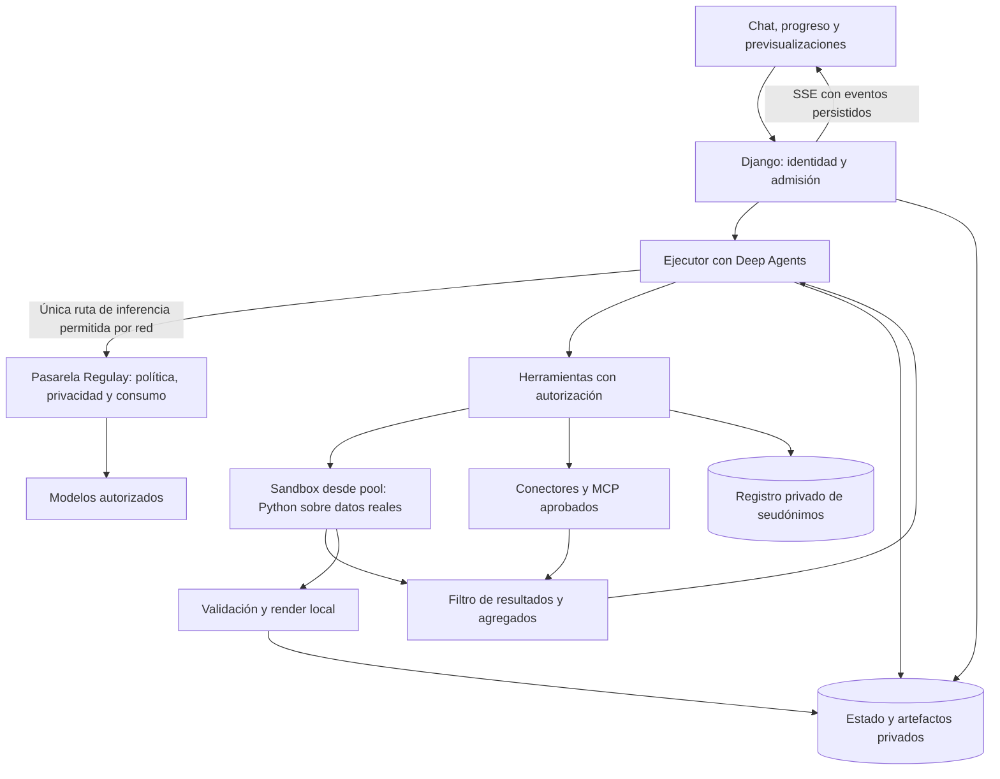

# Plan para dar capacidades agénticas a Regulay

Propuesta del 7 de octubre de 2026, revisión 3 con las prioridades del usuario, elección explícita de Deep Agents e investigación de prompts de Claude Desktop y skills documentales públicas. Basada en la lectura del repositorio local y en documentación primaria de los proyectos citados. Es un plan de evolución; las capacidades descritas están pendientes de implementación y prueba. La revisión incluye cambios locales pendientes sobre `4a0230e`; habrá que fijar una base antes de implementar. Para el nuevo modo agente, esta revisión adopta seudonimización consistente y resolución local, ampliando expresamente la decisión anterior de usar solo máscara irreversible. El comportamiento implementado de Community sigue descrito en sus documentos históricos.

La ejecución se concreta en la [guía de siete prompts](implementacion-agente-regulay-prompts.md), tareas locales 48–54. Esa guía prioriza un backend de sandbox, un ejecutor y un recorrido vertical de Excel antes de ampliar documentos y conectores; divide A1 en dos hitos sin retirar sus controles. Los prompts están preparados, no ejecutados.

La decisión es construir **la experiencia y el control del agente en Regulay con Deep Agents como arnés y un entorno aislado para ejecutar código**. La primera entrega valida su integración con Regulay y compara E2B con OpenSandbox para la ejecución. Así reutilizamos el bucle de herramientas, la gestión del contexto y las skills, mientras Regulay conserva sus permisos, proveedores y política de salida.

Tres prioridades condicionan el diseño y la elección de arnés:

1. **El modelo trabaja con código y vistas autorizadas.** Recibe estructura, tipos, referencias opacas y agregados; Python procesa los datos reales dentro del sandbox. Ninguna herramienta entrega automáticamente filas completas al modelo.
2. **El gobierno se impone en la red.** La pasarela de inferencia de Regulay es la única salida permitida hacia modelos. El control sigue funcionando si un SDK, una skill o el arnés intenta saltarse su adaptador.
3. **Las identidades son estables dentro del chat.** Un registro protegido conserva los seudónimos durante toda la conversación; las herramientas autorizadas resuelven los originales únicamente al ejecutar operaciones locales o efectos permitidos.

SSE, pool de sandboxes precalentados, previsualizaciones, edición incremental y comprobación automática de entregables forman parte del primer recorrido útil. Reducir tokens, latencia y errores es una hipótesis a medir frente al chat actual, no una mejora cuantificada todavía.

El objetivo principal es trabajar con documentos, datos y aplicaciones corporativas, con varios usuarios y empresas. La selección del arnés está cerrada. Rendimiento, calidad, controles y esfuerzo de integración de Deep Agents requieren la prueba inicial; esos son los aspectos que se medirán.

**Qué debería experimentar el usuario**

Un usuario adjunta un Excel y una plantilla y pide: «Comprueba los importes, prepara el informe y déjame ambos archivos». La interfaz responde inmediatamente y muestra «Leyendo el Excel», «Calculando totales por proveedor» y «Comprobando el informe». El modelo recibe una descripción autorizada de los archivos, escribe código, y Python trabaja con los originales. El agente reabre, recalcula y renderiza los resultados antes de entregar una tabla y un documento previsualizables y descargables. «Cambia el título» actualiza ese mismo artefacto conservando sus cálculos y estructura. Un chat nuevo empieza sin el historial ni los archivos del anterior.

Cada conversación tendrá:

| Capacidad | Comportamiento propuesto |
| --- | --- |
| Contexto propio | Historial y estado de trabajo aislados por empresa, usuario y conversación; resumen al alcanzar la ventana del modelo. |
| Terminal | Shell y Python/Node en Linux aislado; código desplegable, retorno de ejecución controlado y parada. El modelo recibe diagnósticos sanitizados. |
| Entrada | Archivos adjuntos conservados según una política explícita y montados en `/workspace/input/`. |
| Trabajo | Scripts, cálculos y archivos intermedios en `/workspace/work/`. |
| Salida | Entregables en `/workspace/output/`, comprobados, previsualizables y editables por referencia estable desde el chat. |
| Skills | Procedimientos con `SKILL.md`, scripts y plantillas que se cargan cuando son pertinentes. |
| Conectores | Cuentas autorizadas del usuario o de su empresa, con alcance de lectura o escritura. |
| MCP | Acceso a herramientas de servidores aprobados a través de los mismos controles. |
| Control | Cancelar y retomar; aprobación únicamente para escribir fuera de Regulay. Leer, calcular, reparar código y editar entregables internos autorizados no generan peticiones de aprobación. |
| Protección visible | Indicador discreto de datos protegidos; explicación y alternativa concreta cuando una restricción impide completar la tarea. |

Las herramientas son las operaciones; una skill explica cómo combinarlas; un conector administra una integración y sus credenciales; MCP es un protocolo para exponer capacidades. Ninguno de ellos sustituye la autorización de Regulay. La separación entre cliente, servidor y capacidades está documentada en la [arquitectura de MCP](https://modelcontextprotocol.io/docs/2026-07-28/learn/architecture).

**Arnés elegido: Deep Agents**

Reutilizar su arnés Python, gestión de contexto, skills, herramientas e interrupciones, sobre LangGraph para ejecución y checkpoints. Regulay implementa identidad, autorización, seudonimización, gobierno de red, archivos y experiencia web. Deep Agents permite personalizar piezas y tiene licencia MIT; la persistencia y el aislamiento efectivo siguen necesitando configuración e integración propias. Fuentes: [repositorio](https://github.com/langchain-ai/deepagents), [licencia](https://github.com/langchain-ai/deepagents/blob/main/LICENSE) y [personalización](https://docs.langchain.com/oss/python/deepagents/customization).

Hermes, OpenHands y Devin fueron alternativas exploradas en la primera revisión. Quedan fuera de la comparación y del desarrollo de esta fase tras la elección del usuario. A0 evaluará exclusivamente Deep Agents y las dos alternativas de sandbox.

**Qué existe ya y qué falta**

La base actual reduce el trabajo de gobierno, pero no contiene todavía el entorno de un agente general.

| Evidencia local | Implicación |
| --- | --- |
| Las tres entradas de envío llaman a `send_chat_message`. | Conservar una admisión común también para el modo agente. Véanse [web](../regulai/front/views.py) y [API](../regulai/api/views.py). |
| `run_pipeline` reúne control de salida, enmascarado, rutas y registro de llamadas. | Extraer la parte reutilizable con pruebas antes de conectarla al arnés. No ejecutar todo el envío de chat recursivamente por cada paso. Véase [chat_service.py](../regulai/front/chat_service.py). |
| `ChatResponse` representa fundamentalmente texto y consumo; no tiene un contrato explícito de llamadas a herramientas. | Añadir mensajes estructurados, identificadores de llamadas y resultados; validar soporte real de cada modelo. Véase [connectors.py](../regulai/front/connectors.py). |
| El historial excluye turnos con adjuntos porque los originales no se retienen. | Añadir conservación y permisos explícitos de archivos para trabajar sobre ellos en varios turnos. No reconstruir originales históricos que no existen. |
| `Message.response_file` permite un archivo generado. | Evolucionar a artefactos con identidad estable, revisiones, previsualización y relación con las fuentes. Véase [models.py](../regulai/front/models.py). |
| La configuración base usa SQLite y Gunicorn ejecuta el chat en hilos HTTP. | Incorporar PostgreSQL, ejecución en segundo plano y un despliegue ASGI probado para SSE desde A1. SQLite puede seguir en pruebas locales de un solo proceso. |
| La máscara local usa sustituciones irreversibles y no conserva diccionarios de identidad. | Añadir un registro de seudónimos separado, con alcance de conversación y resolución restringida a herramientas. Véase [enmascarado local actual](plan-blackhat/enmascarado-local.md). |
| Hay un registro de reservas para evaluaciones autorizadas. | Reutilizar sus invariantes como precedente; no convertir automáticamente ese archivo de laboratorio en la contabilidad del producto. Véase [evaluation_budget.py](../regulai/front/evaluation_budget.py). |

El [plan Community](plan-blackhat/README.md) excluye colas, motores de workflows y ofuscación reversible para aquella edición, y limita la generación a dos intentos. El modo agente amplía expresamente estas decisiones con ejecución de varios pasos y resolución local de seudónimos. Conserva D2 como control obligatorio antes de enviar contenido a un modelo; el registro de identidades y los originales no forman parte de ese contenido. Django seguirá siendo la aplicación y el dueño del dominio. El ejecutor, la pasarela de inferencia y los sandboxes son infraestructura para esta evolución.

También existe una decisión posterior de [dejar los límites de generación al proveedor](plan-blackhat/tareas/44-limites-del-proveedor.md). Debe preservarse. El plan distingue esos límites de los recursos del terminal y del número de acciones del agente; no propone reactivar silenciosamente topes de tokens, tiempo o tamaño en el chat actual.

**Arquitectura propuesta**

El ejecutor puede comenzar como un proceso del mismo proyecto Django que reclama ejecuciones persistidas en PostgreSQL. Su proceso y red están separados del proceso que custodia credenciales y envía inferencias: compartir repositorio no significa compartir secretos o permisos de salida. Para el primer piloto evita añadir Redis/Celery y operar otra cola. Debe incorporar desde el principio una concesión temporal de ejecución, señal de vida y un identificador de propietario que invalide ejecutores antiguos. Si la carga o la operación lo justifican, sustituir el despacho por una cola mantenida; no desarrollar un planificador general.

El servidor web acepta la solicitud y devuelve un identificador; la interfaz presenta actividad inmediatamente y abre un flujo **SSE desde A1**. Las tres entradas existentes comparten la admisión del nuevo modo. Persistir eventos con identificador creciente y permitir reconexión con `Last-Event-ID`; el cursor sirve para recuperar eventos perdidos, no para sustituir SSE en el recorrido principal. Autenticar el flujo y revalidar el acceso al reanudar; el identificador de ejecución no es una credencial. Probar Django bajo ASGI, buffering del proxy, heartbeats, cierre de conexiones y entrega progresiva a través del despliegue real. No hace falta una nueva aplicación React para empezar.

La implementación propuesta tiene tres interfaces pequeñas:

- **Ejecuciones:** iniciar, consultar eventos, responder a una pregunta/aprobación y cancelar. El cliente nunca escoge empresa, credenciales ni rutas físicas.
- **Modelos:** una llamada estructurada a la pasarela que aplica la política de Regulay, preserva el protocolo de herramientas y registra destino y consumo. La política de red obliga a pasar por ella.
- **Herramientas:** validar y ejecutar una operación autorizada, resolver referencias cuando corresponda, producir una vista del resultado apta para el modelo y registrar su estado. El sandbox y MCP son adaptadores concretos de operaciones, con permisos diferentes.

Implementar un único adaptador de Deep Agents, con los tipos de la biblioteca contenidos en él. La variación real que se compara en A0 es el backend de sandbox; la versión del arnés y su configuración quedan fijadas en el resultado.

**Modelo, terminal y datos: controles en los lugares efectivos**

El principal riesgo arquitectónico es filtrar el primer mensaje y dejar después que el arnés llame libremente al modelo o a Internet. **El adaptador de Deep Agents mejora la integración; la obligación de usar Regulay se impone fuera del arnés, mediante la red.** Las llamadas de generación, compactación, verificación, clasificación, visión y cualquier futuro subagente pasan por la misma pasarela. Deep Agents admite un modelo personalizado; su integración con el control actual se debe demostrar en A0. Fuente: [contrato de personalización](https://docs.langchain.com/oss/python/deepagents/customization).

El ejecutor carece de credenciales de proveedores y tiene una política de salida denegada por defecto: solo puede contactar la pasarela y las interfaces internas de herramientas/estado que necesite. El sandbox y los procesos MCP tampoco pueden salir directamente a proveedores, proxies alternativos o Internet. Las reglas se aplican en la red del host o plataforma, no mediante variables de proxy que una biblioteca pueda ignorar. Cubrir IPv4/IPv6, IP literal, DNS, redirecciones, túneles y metadatos cloud. Solo la pasarela dispone de rutas y credenciales para los modelos permitidos.

La pasarela autentica una identidad de ejecución de corta duración, vinculada en servidor a empresa, usuario y permisos. No acepta un `company_id`, `base_url` o modelo arbitrario como autorización. Revalida política, destinos y revocación; preserva mensajes estructurados y registra cada intento. Si falla, cierra la salida. Un endpoint compatible con un SDK no es un proxy HTTP genérico. Las herramientas de búsqueda y descarga y los conectores corporativos necesitan su propia salida limitada y validación de destino para evitar que sirvan de túnel. Inferencias solicitadas por un MCP solo se admiten por la pasarela; un servicio remoto que no permita controlar sus inferencias no se trata como parte del arnés gobernado.

La política se comprueba antes de cada efecto, con revalidación del usuario, empresa, herramienta, destino y versión de permisos. Los nombres y argumentos de herramientas se validan contra esquemas en servidor. Se conservan los identificadores estructurales del protocolo; el enmascarado se aplica al contenido autorizado sin corromper el JSON ni las relaciones entre llamadas y resultados.

**E2B y OpenSandbox se comparan en A0**, con el mismo conjunto de tareas, imagen documental equivalente y controles de red. Son decisiones independientes del arnés ya elegido.

| Sandbox | Encaje documentado | Qué demostrar en A0 |
| --- | --- | --- |
| E2B | SDKs Python/JavaScript, ejecución de código y archivos; infraestructura abierta y opción E2B Embed autohospedada. | Imagen con LibreOffice, virtualización del host, latencia con pool, red efectiva, aislamiento, persistencia de archivos y operación. |
| OpenSandbox | Ejecución y archivos en infraestructura propia, con soporte documentado para runtimes como gVisor y Kata. | Los mismos recorridos; coste del adaptador de Deep Agents y operación de pool/red en el host disponible. |

E2B publica su proyecto bajo Apache 2.0. Su guía de Embed documenta despliegue en una máquina Linux con virtualización y una interfaz HTTP que requiere protección de transporte en nuestra infraestructura. Se distingue esa opción de E2B Cloud y BYOC: compartir API no demuestra idénticos costes, capacidades o condiciones operativas. Fuentes: [repositorio E2B](https://github.com/e2b-dev/E2B), [licencia](https://github.com/e2b-dev/E2B/blob/main/LICENSE) y [E2B Embed](https://github.com/e2b-dev/runtime/blob/main/embed/README.md).

Para OpenSandbox, probar un host Linux dedicado con Docker y gVisor; evaluar Kata si las herramientas requeridas no funcionan. Un Docker corriente sirve para desarrollo controlado, pero no se dará por probado el aislamiento entre empresas. No introducir Kubernetes hasta necesitarlo. Fuentes: [proyecto Apache 2.0](https://github.com/opensandbox-group/OpenSandbox) y [runtimes de aislamiento](https://github.com/opensandbox-group/OpenSandbox/blob/main/docs/guides/secure-container.md).

Deep Agents documenta una integración con E2B y backends de ejecución sustituibles; el adaptador a OpenSandbox es trabajo a validar. Disponer de un adaptador no demuestra el cumplimiento de la política de Regulay. Fijar versiones, verificar transferencias de archivos y probar ambas opciones; el sandbox por sí solo no evita instrucciones maliciosas ni extracción de datos por una red abierta. Fuente: [sandboxes de Deep Agents](https://docs.langchain.com/oss/python/deepagents/sandboxes).

Configuración inicial propuesta:

- Ningún código del agente se ejecuta en el proceso web, en el host de Django ni con acceso a su base de datos o al socket de Docker.
- Imagen fijada por digest, usuario sin privilegios y cuotas de CPU, memoria, disco y procesos. Paquetes documentales preinstalados; nuevas dependencias entran por una actualización revisada de la imagen.
- Red saliente del sandbox denegada. Las búsquedas, descargas e integraciones usan herramientas controladas; bloquear también DNS no autorizado, metadatos cloud, redes privadas y redirecciones no permitidas.
- Las credenciales de inferencia permanecen en la pasarela y las de aplicaciones en el módulo de conectores. El agente maneja referencias opacas, no claves en el prompt o variables de entorno.
- Los permisos de `/workspace/input/` y `/skills/` se aplican con montajes y controles del sistema, no solo con reglas del arnés. Una shell podría esquivar restricciones aplicadas únicamente a `read_file`.

**Código sobre datos reales y vistas para el modelo**

El recorrido habitual es: inspeccionar esquema → generar código → ejecutar en privado → validar → devolver agregados y referencias de artefactos. El modelo recibe columnas autorizadas, tipos, dimensiones y muestras sintéticas cuando ayuden. Los nombres de columnas y archivos también pasan por el control de privacidad. El backend de archivos de Deep Agents no expone lecturas crudas de originales ni carga automática de su contenido en el contexto.

Python puede leer los originales montados dentro del sandbox. Un filtro de resultados externo al proceso de código generado decide qué sale hacia el arnés: resultados con esquema, agregados permitidos, errores sanitizados e identificadores opacos. `stdout`, `stderr`, excepciones, variables de notebooks, imágenes y resultados de archivos no se incorporan directamente a mensajes del modelo. Las referencias permiten que el usuario abra un archivo con sus permisos; no convierten ese archivo en contexto autorizado del modelo. Antes de cada envío se mantienen YARA, D2 y la política del destino.

Una agregación puede identificar a alguien si contiene un grupo de una sola persona o un dato raro. Validar el contenido y la granularidad según la política; no equiparar «agregado» a «anónimo». Detectar también respuestas y diagnósticos que incorporen nombres, filas originales o datos codificados. Con Python arbitrario no se puede garantizar la ausencia de todos los canales de extracción solo examinando texto: para datasets que exijan una garantía más fuerte, restringir las operaciones a funciones de cálculo revisadas. Declarar esa limitación y probarla; no atribuirla a una promesa del prompt.

Para preguntas documentales que requieren significado textual, devolver fragmentos seleccionados y seudonimizados mediante una herramienta de extracción; no intentar resolver toda comprensión documental únicamente con agregados. Si la política no permite un fragmento necesario, explicar qué falta y proponer una extracción o transformación local compatible.

**Seudonimización consistente por conversación**

El nuevo modo mantiene un registro privado de correspondencias. El mismo identificador normalizado recibe el mismo token durante todos los turnos, herramientas, compactaciones y recuperaciones del chat. Otro chat usa tokens independientes. Ejemplo: una persona conocida se referencia como `PERSONA_<id_aleatorio>`; atributos como DNI tienen tokens tipados y relaciones internas con esa entidad cuando existe evidencia suficiente. Los tokens no codifican el original y no se calculan con un hash público de un DNI de baja entropía.

Persistir originales cifrados y referencias bajo empresa, propietario, conversación, tipo y versión. La asignación debe ser atómica y tolerar llamadas concurrentes sin producir tokens diferentes para el mismo valor. La normalización es específica del campo; no unir personas por compartir nombre ni hacer inferencias de identidad con el modelo. Vincular alias solo con identificadores o relaciones verificadas. Una entidad ambigua permanece separada. La estabilidad se garantiza sobre valores reconocidos y registrados, no sobre datos que el detector haya omitido.

El registro vive fuera del filesystem del sandbox, del estado de Deep Agents y del contexto. Una herramienta confiable recibe token y operación, revalida permisos y resuelve únicamente los valores necesarios dentro de su implementación. El modelo y el Python arbitrario no disponen de una función general para recuperar correspondencias. Procesar un archivo real no concede acceso al registro completo. Los valores resueltos pueden usarse en un entregable privado o un destino externo aprobado, y sus resultados vuelven a atravesar el filtro de salida.

Preservar los tokens al reaplicar D2; validar identificadores estructurales, impedir colisiones y rechazar tokens desconocidos o de otra conversación. Reutilizar correspondencias al reintentar una tarea y restaurar un checkpoint. Las claves y secretos técnicos continúan redactándose de forma irreversible o permanecen bajo referencias de credenciales; no se convierten en identidades recuperables por el agente.

El borrado de conversación revoca la resolución y elimina su registro según la política de retención, incluidas las copias de seguridad cuando expiren. Los indicadores y registros operativos muestran categorías y cantidades, nunca diccionarios de correspondencias. Esta es una capacidad nueva del modo agente, no una propiedad que ya tenga el enmascarado local de Community.

Las instrucciones dentro de documentos, páginas, resultados MCP y archivos generados son datos no confiables. Una skill puede orientar al agente; no puede ampliar permisos, cambiar destinos o autorizar sus propias acciones.

**Vida de una conversación y sus archivos**

Crear un chat genera una identidad de trabajo nueva. Hereda la configuración autorizada de herramientas y skills, pero no las conversaciones, procesos, archivos ni memoria aprendida de otros chats. Inicialmente no habrá memoria personal transversal. La configuración de empresa sí puede ser común.

Dentro del mismo chat persisten historial, checkpoints, seudónimos y archivos durante su retención. El sandbox se asigna desde un **pool precalentado** de entornos limpios, sin datos, secretos o correspondencias de usuarios. Asignación exclusiva y atómica por conversación; después de usarlo se destruye y el pool se repone desde una imagen limpia. No devolver al pool un entorno limpiado parcialmente de una empresa. Fijar tamaño mínimo/máximo, cuotas por empresa, reposición, TTL y coste del tiempo ocioso a partir de la carga observada.

El almacenamiento durable permanece separado. Al reabrir el chat se asigna otro entorno limpio y se recuperan archivos y versión de imagen; las correspondencias se mantienen en su registro privado. Esto no implica restaurar procesos vivos o variables de una shell. El modo que conserve memoria de procesos requeriría pruebas específicas de snapshots y aislamiento. Ante un pool agotado, responder y mostrar espera real inmediatamente; medir los arranques fríos y no ocultarlos en las métricas.

| Ruta lógica | Acceso del agente | Conservación |
| --- | --- | --- |
| `/workspace/input/` | Lectura de copias inmutables autorizadas. | Retención de la empresa, visible al adjuntar. |
| `/workspace/work/` | Lectura y escritura. | Solo lo necesario para continuar durante esa retención. |
| `/workspace/output/` | Escritura de candidatos a entregables. | Identidad lógica estable y revisiones inmutables comprobadas al publicar en el chat. |
| `/skills/` | Lectura de versiones habilitadas. | Catálogo administrado; no es memoria de conversación. |

Registrar empresa, propietario, conversación, ejecución, hash, tamaño, MIME, origen, versión y fecha de borrado. Validar rutas y enlaces simbólicos; no aceptar rutas del modelo como claves de almacenamiento. Las descargas requieren autorización actual. Las previsualizaciones HTML/SVG y otros contenidos activos se aíslan o se ofrecen como descarga, sin ejecutarse en el origen de Regulay.

La conservación de originales se activa de forma explícita para el modo agente: es un cambio respecto al comportamiento actual. Propuesta inicial para el piloto: 30 días configurables, con borrado manual del chat que cierre ejecuciones y programe limpieza de archivos, previsualizaciones, registro de seudónimos, checkpoints y cachés. La política de backups debe establecer cuándo desaparecen sus copias. Los chats antiguos no adquieren archivos por una migración.

**Fluidez, previsualización y edición**

La interfaz acusa recibo al pulsar enviar y el servidor emite `run.accepted` sin esperar al modelo o al sandbox. Los eventos de trabajo se traducen con un catálogo de mensajes: «Preparando el entorno», «Leyendo el Excel», «Calculando totales por proveedor», «Comprobando las fórmulas» y «Generando el informe». Describen operaciones observadas, sin inventar porcentajes ni publicar razonamiento privado. El código y los diagnósticos permitidos quedan desplegables.

Objetivos iniciales para medir, no resultados acreditados: respuesta visual local en menos de 100 ms, primer evento SSE p95 menor de 1 s desde la admisión y entorno precalentado listo p95 menor de 2 s. Medir subida de archivo, preparación, primer evento y primera operación útil por separado, con 1, 5 y 10 ejecuciones concurrentes. Un evento inmediato no compensa 20 segundos de espera oculta: si el arranque incumple el objetivo, ajustar pool/imagen antes de avanzar.

El XLSX se muestra como tabla paginada con formatos y resultados calculados; DOCX/PDF como documento renderizado. Los originales y sus vistas privadas se entregan al navegador del usuario autorizado. Esa autorización no permite adjuntarlos a un modelo de visión. La UI conserva una tarjeta por artefacto con su revisión actual y permite abrir revisiones anteriores.

«Cambia el título» se convierte en una edición sobre el `artifact_id` y la revisión esperada. Modificar el documento o celdas afectados, conservar fórmulas, estilos y cálculos, volver a validar y publicar la nueva revisión de forma atómica en la misma tarjeta. Controlar conflictos por revisión. Se puede regenerar el PDF de previsualización cuando el conversor lo necesite, sin rehacer el análisis ni pedir al modelo el documento entero.

El indicador de protección muestra, por ejemplo, «Identidades protegidas», con detalle opcional de categorías y alcance. No afirma «todo anonimizado». Si falta información imprescindible, el agente explica la limitación y ofrece un cálculo local, un fragmento seudonimizado o una selección más concreta. Preguntar por información necesaria se distingue de pedir permiso: no se interrumpe una lectura o cálculo ya autorizado.

**Skills, conectores y acciones externas**

Empezar con pocas skills de calidad: **Excel**, **Word desde plantillas corporativas** y **PDF/revisión documental con evidencias**. Cada paquete incluye versión, procedencia, licencia, imagen compatible, pruebas con ejemplos, precondiciones y comprobaciones obligatorias antes de entregar. Su descripción se carga al inicio y el contenido cuando se usa. Deep Agents documenta carga progresiva de `SKILL.md`; el formato necesita buenos procedimientos y pruebas para producir buenos resultados. Fuente: [capacidades de Deep Agents](https://docs.langchain.com/oss/python/deepagents/overview).

La [investigación documental](investigacion-prompts-skills-documentales-2026-10-07.md) añade **PPTX** al alcance de A3. Selección provisional: BrandDocs para plantillas DOCX y, cuando proceda, XLSX/PPTX; OfficeCLI para evaluar edición general y PPTX; skill PDF pública de OpenAI como base. Mantener Python/openpyxl y recálculo independiente para datos. Son candidatas con código y licencia consultados, todavía sin una comparación de calidad ejecutada. `dom-to-pptx` y GenOffice quedan como alternativas acotadas, sin añadirlas todas a la imagen inicial.

Imagen base fijada con Python, pandas, openpyxl, python-docx, LibreOffice headless, utilidades de render PDF y fuentes con soporte verificado de tildes, ñ y símbolos monetarios. Node y sus paquetes se preinstalan si una skill concreta los usa. Incorporar UTF-8, locales, formatos de fecha y moneda probados. El arranque de cada imagen comprueba importaciones, conversión y fuentes con fixtures; no descubrir librerías ausentes durante el trabajo del usuario. Deshabilitar macros, enlaces externos y accesos de red del conversor.

En Excel, escribir fórmulas reales, formatos de número, fechas, anchos, tablas y estilos. **openpyxl no calcula fórmulas**: abrir y recalcular una copia con LibreOffice, leer los valores calculados y contrastar los totales con un cálculo independiente. Detectar errores como referencias rotas y resultados no calculados. Fuente: [documentación de fórmulas de openpyxl](https://openpyxl.readthedocs.io/en/stable/simple_formulae.html). Probar compatibilidad de las fórmulas y plantillas admitidas; no asumir equivalencia completa con Excel.

En Word, rellenar plantillas conservando estilos, cabeceras, pies, tablas y numeración; renderizar y comprobar saltos, desbordamientos y caracteres. En PDF, comprobar apertura, páginas, texto esperado y render. Las bibliotecas y las fuentes también requieren registrar sus licencias al construir la imagen.

**Reutilización de Claude: prompts, herramientas y skills**

La dirección de producto es reproducir la experiencia de trabajo de Claude sobre Deep Agents y priorizar la reutilización directa de componentes públicos con permiso de uso. Para cada incorporación registrar URL oficial, archivo, commit, licencia, avisos y adaptaciones. La publicación en GitHub o en una página de documentación no sustituye la licencia del contenido concreto.

| Material | Evidencia consultada | Incorporación al plan |
| --- | --- | --- |
| Prompts de sistema publicados por Anthropic | El índice oficial describe prompts base de web/móvil; el texto consultado también menciona Desktop. No se ha localizado un paquete oficial íntegro de Desktop/Cowork con licencia permisiva. | Referencias incorporadas al manifiesto y prompt original de Regulay preparado. No importar extracciones de Reddit como textos auténticos ni copiar íntegramente materiales sin permiso identificado. |
| Herramientas de archivos, búsqueda y shell | La documentación y los ejemplos públicos describen estas capacidades; los términos y licencias se deben comprobar por implementación. | Ofrecer equivalentes con los backends de Deep Agents: lectura controlada, escritura/edición, búsqueda y ejecución. Reutilizar código permisivo compatible cuando exista; un nombre de herramienta público no demuestra que su implementación completa lo sea. |
| `mcp-builder` y `skill-creator` de Anthropic | Sus archivos `LICENSE.txt` consultados indican Apache 2.0. | Candidatas a copiar y adaptar conservando avisos, útiles para construir conectores y el catálogo; habilitar solo donde aporten valor. |
| `docx`, `xlsx`, `pptx` y `pdf` de Anthropic | El repositorio las identifica como código disponible con licencia propietaria; sus licencias restringen copia, obras derivadas y distribución. | Referencia de capacidades; implementar nuestras skills documentales a partir de requisitos propios y bibliotecas autorizadas, salvo que exista un permiso específico aplicable. |

Fuentes de los prompts: [publicación oficial](https://platform.claude.com/docs/en/release-notes/system-prompts/overview). Para herramientas, [SDK y términos publicados](https://github.com/anthropics/claude-agent-sdk-python) y [ejemplo oficial de herramientas](https://github.com/anthropics/claude-agent-sdk-demos/blob/main/hello-world/README.md). El SDK envuelve el runtime de Claude; usar sus ejemplos no requiere sustituir Deep Agents ni demuestra que todo el runtime esté bajo la licencia de un archivo del SDK.

Licencias verificadas: [mcp-builder](https://github.com/anthropics/skills/blob/main/skills/mcp-builder/LICENSE.txt), [skill-creator](https://github.com/anthropics/skills/blob/main/skills/skill-creator/LICENSE.txt), [DOCX](https://github.com/anthropics/skills/blob/main/skills/docx/LICENSE.txt), [XLSX](https://github.com/anthropics/skills/blob/main/skills/xlsx/LICENSE.txt), [PPTX](https://github.com/anthropics/skills/blob/main/skills/pptx/LICENSE.txt) y [PDF](https://github.com/anthropics/skills/blob/main/skills/pdf/LICENSE.txt). La propia [presentación del repositorio](https://github.com/anthropics/skills) distingue los dos grupos. Esta revisión consulta las licencias; no incorpora archivos de esas skills al producto.

El prompt de Regulay se ensambla con identidad y normas estables, catálogo real de herramientas, contexto autorizado y skills activadas. Ajustar nombres de operaciones, rutas y manejo de errores a nuestra implementación; evitar promesas de herramientas que no existen. Probar compatibilidad y conflictos con las instrucciones internas de Deep Agents. El prompt indica trabajar mediante código y verificar resultados, mientras la red y las herramientas imponen los permisos.

Ya están preparados el [prompt de sistema y complemento documental](agent-assets/README.md), las referencias y una copia de la skill PDF Apache 2.0 de OpenAI con su licencia. Son archivos locales para la futura integración, no un cambio del chat actual. El [informe de investigación](investigacion-prompts-skills-documentales-2026-10-07.md) distingue material oficial, testimonios de Reddit, código inspeccionado y pruebas pendientes.

**Comprobación y reparación antes de entregar**

La verificación forma parte de cada skill desde A1: reabrir el archivo generado, comprobar estructura y contenido esperado, recalcular cuando corresponda, renderizar y examinar el resultado. El proceso que genera código no puede convertir su propia afirmación de éxito en una prueba: un verificador separado produce evidencias ligadas al hash de la revisión final.

Los fallos de código o de comprobación activan corrección automática sin pedir aprobación. Propuesta inicial: hasta tres reparaciones por etapa si hay progreso verificable; después entregar una explicación concreta y conservar el trabajo recuperable. No repetir automáticamente efectos externos. Un archivo que falla las comprobaciones no se presenta como terminado.

Las comprobaciones visuales usan un verificador local o renders seudonimizados preparados antes de rasterizar y enviados por la pasarela a un modelo de visión autorizado. La previsualización con datos reales destinada al usuario no se envía al modelo. En A1 comprobar al menos tablas cortadas, saltos, fuentes y contenido esperado, y registrar la cobertura real de la revisión visual.

**Modelo del modo agente**

Usar un perfil propio con un modelo de primer nivel autorizado, seleccionado por calidad de llamadas a herramientas, programación, seguimiento de instrucciones y corrección de errores. Mantener separados los perfiles de agente y del chat normal; no heredar automáticamente una ruta Flash/Pro que priorice coste para consultas sencillas. Fijar identificador y configuración y evitar degradación silenciosa a un modelo más débil.

Validar el perfil con el corpus de tareas y medir éxito, reparaciones, latencia y coste por entrega correcta. Un transporte simulado valida contratos, no inteligencia del modelo. Si no existe un modelo adecuado autorizado, continuar las pruebas offline y dejar la validación de calidad pendiente. Optimizar con código, agregados, caché y menos contexto antes de rebajar la capacidad del modelo principal. Se mantiene la decisión de límites gestionados por el proveedor.

**Conectores y permisos durante el trabajo**

Un administrador habilita paquetes; el agente no instala ni actualiza automáticamente skills o servidores. Las herramientas efectivas son la intersección entre las disponibles y las autorizadas para esa empresa, usuario y ejecución. El catálogo inicial puede vivir en archivos versionados y configuración validada, sin marketplace propio.

Incorporar después un conector documental real. Google Drive puede servir de primer recorrido; sustituirlo por Microsoft 365 si ahí están los documentos del piloto. Ese dato sigue pendiente y no afecta al primer recorrido con archivos adjuntos.

MCP se integra mediante un cliente del ejecutor o del módulo de herramientas. Los servidores remotos usan destinos aprobados y credenciales con alcance mínimo; los locales `stdio` corren en un proceso aislado, sin heredar secretos del servidor web. Validar esquemas, identidad del servidor y resultados; un cambio de catálogo no otorga permisos nuevos. Las anotaciones «read-only» de un servidor no bastan para autorizarlo. Comenzar con lectura, búsqueda y descarga. Deshabilitar capacidades MCP no necesarias, incluidas solicitudes de inferencia del servidor si no pasan por el acceso gobernado a modelos.

La única categoría de acciones que pide aprobación durante el trabajo es **escribir fuera de Regulay**, incluidos envíos, modificaciones y borrados externos. La interfaz enseña una propuesta concreta: cuenta, destino, contenido y efecto. La autorización se vincula a esos argumentos, empresa, usuario, versión y caducidad y se revalida al ejecutar. Lecturas, cálculos, ejecución local, reparación de código y edición de artefactos internos autorizados continúan sin confirmaciones. La política del modo debe expresar esos permisos antes del trabajo; una operación prohibida se bloquea con explicación y alternativa, sin convertirla en una solicitud repetitiva de consentimiento. Ninguna aprobación levanta un bloqueo obligatorio. Las interrupciones de Deep Agents implementan la pausa; la autorización durable pertenece a Regulay. Fuente: [interrupciones y revisión humana](https://docs.langchain.com/oss/python/deepagents/human-in-the-loop).

**Persistencia, recuperación y costes**

Conservar `Prompt` como registro principal de la solicitud. Añadir registros subordinados de ejecución, pasos y artefactos; la ficha actual muestra el resumen y enlaza el detalle. Los checkpoints del arnés son estado interno, no otra fuente de autorización ni otro registro contable. Evitar un JSON creciente que varios procesos actualicen a la vez.

Estados propuestos: en cola, ejecutando, esperando entrada/aprobación, cancelación solicitada, completado, fallido, cancelado y resultado desconocido. Solo una ejecución escribe en el workspace de una conversación a la vez. Un nuevo mensaje se encola o solicita detener la ejecución en curso; no cambia silenciosamente sus archivos mientras trabaja.

Reintentar una petición HTTP con el mismo identificador devuelve la ejecución existente. Reintentar una herramienta externa requiere una clave idempotente o reconciliar el resultado. Un fallo después de enviar un correo no permite asumir que no se envió. Cancelar detiene pasos posteriores y procesos del sandbox; no deshace efectos ya confirmados ni garantiza que el proveedor haya dejado de facturar una solicitud en vuelo.

En cada paso persistir intención y estado antes del efecto. Al recuperar un ejecutor, revalidar permisos y distinguir entre pasos aún no iniciados y efectos inciertos. Usar transacciones cortas; nunca mantener un bloqueo de base de datos esperando al modelo. No prometer ejecución exactamente una vez sobre servicios externos.

La UI muestra actividad y resultados útiles, no razonamiento privado. Trazas operativas con identificadores, motivos y cantidades; contenido y salidas completas en almacenamiento privado con su propia retención. Evitar exportar prompts o archivos automáticamente a servicios de observabilidad.

Registrar coste por ejecución: inferencia principal, compactación, verificación, herramientas de pago y tiempo/almacenamiento de sandbox. Atribuir también el coste ocioso del pool, las conversiones y el render. El precio de licencia abierto no elimina estos costes. Medir tareas completadas, pasos, latencia y coste por resultado útil; no presentar ahorro sin comparación.

Para detectar bucles, proponer un número configurable de acciones y falta de progreso, además de un botón de parada. CPU/disco/procesos se limitan en el sandbox. El modo actual «límites del proveedor» conserva su comportamiento de generación. Si una empresa pide un presupuesto monetario duro, hay que disponer de cotas de llamada y reservas atómicas compatibles; con generación sin cota solo se pueden mostrar consumo y alertas, no garantizar ese techo. Las llamadas inciertas mantienen su exposición reservada cuando exista presupuesto.

**Entregas en orden de dependencia**

Estimación revisada para dos personas con experiencia en Python/web, apoyo parcial de infraestructura y revisión: **8–12 semanas hasta un piloto de alcance acotado**. Adelantar gobierno de red, registro de seudónimos, SSE, pool, render y edición incremental aumenta el trabajo de la primera entrega respecto a la revisión original. Los rangos son días laborables transcurridos del equipo, con algunas tareas que pueden solaparse; se reestiman al finalizar A0. No incluyen certificación, catálogo amplio de conectores, acceso general a navegadores ni operación a gran escala.

| Entrega | Depende de | Resultado verificable | Rango |
| --- | --- | --- | --- |
| A0. Integración y sandbox | Ninguna | Deep Agents funciona con un modelo simulado detrás de la pasarela. Comparar E2B/OpenSandbox con las mismas operaciones, pool, red y conversión; demostrar rechazo de una salida directa. Validar el inventario preparado de prompts/skills al seleccionar archivos y dependencias. Fijar versiones y backend. | 6–8 días |
| A1. Primer recorrido completo | A0 | Desde las tres entradas: CSV/XLSX → Python con datos reales → XLSX con fórmulas y DOCX/PDF breve. Incluir seudónimos, SSE, pool, progreso humano, reapertura/recálculo/render, previsualización y cambio de título incremental. Cero aprobaciones para este recorrido interno. | 10–14 días |
| A2. Continuidad y recuperación | A1 | Varios turnos con identidades estables, reconexión SSE, reinicio del ejecutor, cancelación, retención y separación entre usuarios. Pruebas de pool agotado y ausencia de datos de un ocupante anterior. | 6–9 días |
| A3. Skills y calidad documental | A2 | Consolidar las tres skills iniciadas en A1 y añadir PPTX editable: plantillas, casos difíciles, fórmulas/formato, render y reparación; comparar las candidatas seleccionadas, con licencias y dependencias fijadas. | 5–9 días; reestimar tras evaluar PPTX |
| A4. Conector y MCP | A2 | Un conector documental de solo lectura y un servidor MCP aprobado funcionan con revocación, resolución local de referencias y datos de dos empresas; ninguna vía de inferencia evita la pasarela. | 5–8 días |
| A5. Escrituras y piloto | A3, A4 | Acción externa revisable, recuperación sin duplicados, pruebas adversarias y piloto con modelo de primer nivel, métricas de privacidad, calidad, interrupciones, latencia y costes. | 8–12 días |

La demostración de A0/A1 se estima en **3–5 semanas acumuladas**. A0 produce evidencia técnica, no una promesa de que la integración ya existe. El arnés no se vuelve a comparar: si aparece una incompatibilidad, ajustar su adaptador o configuración y registrar el límite. Un backend de sandbox solo pasa a A1 si demuestra los controles y la imagen requerida. Si ninguno lo consigue, resolver ese requisito antes de activar el modo; no omitir la pasarela o el aislamiento para completar una demo.

Comparar los sandboxes con un mismo script y conjunto de archivos antes de validar la combinación elegida con Deep Agents; evitar multiplicar todas las variantes de framework, modelo y sandbox. Registrar arranque frío/caliente p50/p95, primera operación útil, reconexión, conversión, transferencias, CPU/memoria, coste de pool y esfuerzo operativo. Las cifras comerciales de un proveedor no sustituyen esas medidas.

La aceptación inicial se prepara sin proveedores de pago: SDK real con transporte simulado, herramientas falsas para efectos externos y archivos sintéticos. Las pruebas con modelos reales tendrán que recibir una autorización y presupuesto nuevos; ninguna autorización histórica del piloto se reutiliza automáticamente.

**Pruebas que determinan si se puede avanzar**

| Recorrido | Resultado exigido |
| --- | --- |
| Excel a informe | Fórmulas reales, recálculo independiente, apertura y render correctos; un segundo turno cambia el título de la misma tarjeta sin rehacer el análisis ni perder estilos. |
| Código sobre datos | El modelo recibe esquema, datos sintéticos y agregados autorizados. Ninguna lectura genérica, stdout, excepción, notebook o imagen entrega filas originales al contexto. |
| Red obligatoria | SDK directo, endpoint alternativo, IP literal, IPv6, DNS, redirección y MCP no permiten inferencia fuera de la pasarela; una caída de esta cierra la salida. |
| Seudónimos | Mismo dato reconocido mantiene token entre turnos, herramientas, compactación, concurrencia y reinicio. Otro chat usa tokens distintos; no se fusionan homónimos ni se resuelven tokens ajenos. |
| Resolución local | Las herramientas resuelven solo los campos necesarios para una operación autorizada. Ni el modelo, ni la shell, ni los logs pueden consultar el registro de correspondencias. |
| Fluidez | Se miden respuesta local, primer SSE, primer trabajo útil y arranques fríos/calientes. Eventos describen trabajo real y se recuperan sin repetir efectos. |
| Pool | Asignación exclusiva, reposición, cuotas y agotamiento observables; un entorno usado nunca vuelve al pool común con datos o secretos. |
| Reparación automática | Error de código, fórmula o render activa corrección y nueva comprobación; no pide permiso ni entrega como válido un archivo defectuoso. |
| Previsualización privada | El usuario autorizado puede ver resultados reales; la imagen completa no se incorpora al modelo de visión. Versiones y permisos coinciden con el archivo descargado. |
| Skills e imagen | Imports, LibreOffice, fórmulas, fuentes con tildes/ñ, plantillas y conversión pasan fixtures; cada archivo reutilizado tiene procedencia y licencia verificadas. |
| Interrupciones | Leer, calcular, reparar y editar dentro de Regulay no muestra aprobación; una escritura externa sí muestra propuesta vinculada a la acción. |
| Modelo del agente | Perfil de primer nivel con versión fijada y pruebas de herramientas; no cae silenciosamente al modelo económico del chat. |
| Nuevo chat | No accede al estado, archivos, memoria ni procesos del anterior, aunque el agente adivine identificadores. |
| Dos empresas y dos usuarios de una empresa | Sin acceso cruzado por descarga, evento, checkpoint, conector, permiso heredado o ruta. |
| Entrada web antigua, AJAX y REST | Mismas decisiones de empresa, política, consentimiento y modo de ejecución. |
| Terminal o documento con datos sensibles | La pasarela recibe y valida contenido autorizado; se revisan compactación, diagnósticos, resultados de herramientas y grupos agregados pequeños. |
| Documento con instrucciones maliciosas | No puede obtener credenciales, habilitar herramientas, salir por HTTP/DNS o modificar skills. |
| Esquema MCP cambiado o token revocado | Se rechaza o suspende el siguiente efecto; no se conserva autoridad por tener un checkpoint. |
| Caída antes/después de un efecto externo | Se recupera o se declara incertidumbre; no se duplica automáticamente el efecto. |
| Cancelación y dos pestañas | No aparecen dos escritores del workspace ni un nuevo paso después de perder la concesión de ejecución. |
| Migración desde datos existentes | Se conservan conversaciones y permisos; no se activa retención ni modo agente retroactivamente. |
| Dinero y límites | Cada llamada tiene estado y consumo/coste conocido o desconocido; se respeta «límites del proveedor» y no se promete un presupuesto incompatible. |
| Borrado y limpieza | Se revoca acceso y se eliminan archivos, vistas, correspondencias y checkpoints según política, sin procesos abandonados. |

Proponer un corpus inicial de 16 tareas de documentos/datos, cuatro por formato según la investigación documental, y repetir cada una tres veces con las mismas entradas, modelo y permisos. Incluir fórmulas, plantillas, tildes/ñ, errores reparables, nombres ambiguos, identidades repetidas y ediciones incrementales. Antes de evaluarlo, fijar la rúbrica: por ejemplo, al menos 80 % de tareas completadas correctamente para un piloto asistido y todas las pruebas críticas de aislamiento/autorización superadas. Son objetivos propuestos, no resultados observados ni prueba de ausencia de vulnerabilidades. Medir resultado correcto, cero aprobaciones en recorridos internos, protección explicada cuando impide una tarea, coste total, tokens y latencia. Conservar los fallos y resultados parciales en el informe.

Activar por empresa y usuario de prueba. La reversión deshabilita nuevas ejecuciones, cancela o reconcilia las activas y mantiene disponibles las descargas autorizadas y el historial. Las migraciones iniciales son aditivas; apagar el modo no elimina datos del chat.

**Primera decisión concreta**

Iniciar A0 con **Deep Agents elegido**, modelo simulado tras la pasarela y E2B/OpenSandbox como únicas alternativas de sandbox. El recorrido será CSV/XLSX → cálculo local → fórmulas verificadas → informe renderizado → cambio de título, con datos sintéticos repetidos que permitan comprobar los seudónimos. A0 debe resolver gobierno por red, contrato de datos hacia el modelo, integración de identidades, imagen documental y operación del pool. Preparar el perfil de modelo de primer nivel para una evaluación real cuando exista autorización.

El resultado de esta fase será una demostración técnica repetible, medidas, versiones fijadas, backend de sandbox seleccionado e inventario de componentes públicos de Claude con su tratamiento de licencia. La primera experiencia documental completa se entrega en A1. Las tareas locales [48–54](implementacion-agente-regulay-prompts.md) ya están preparadas siguiendo el [tracker del proyecto](agents/issue-tracker.md), con prompts, dependencias y comprobaciones; su evidencia de implementación sigue pendiente.
