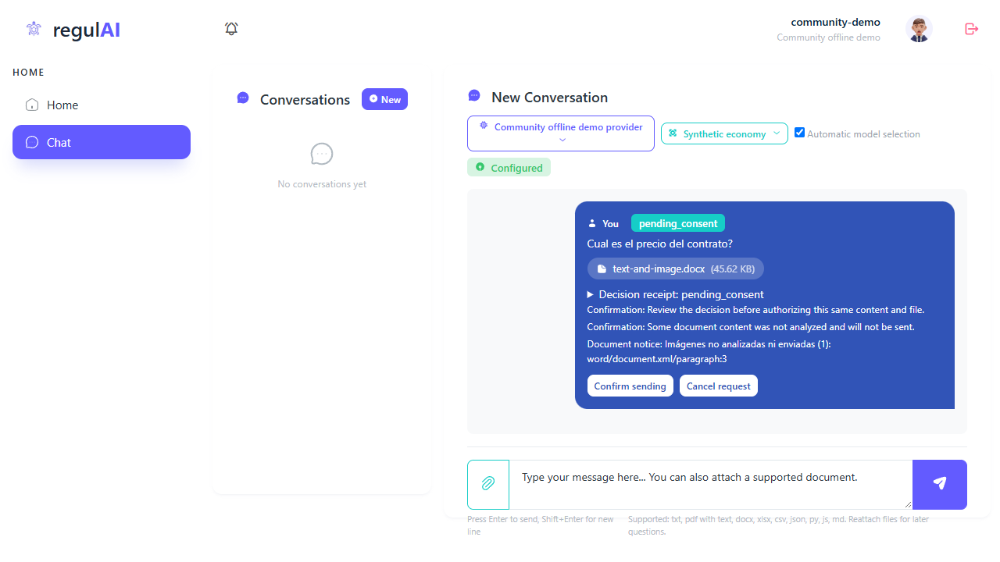
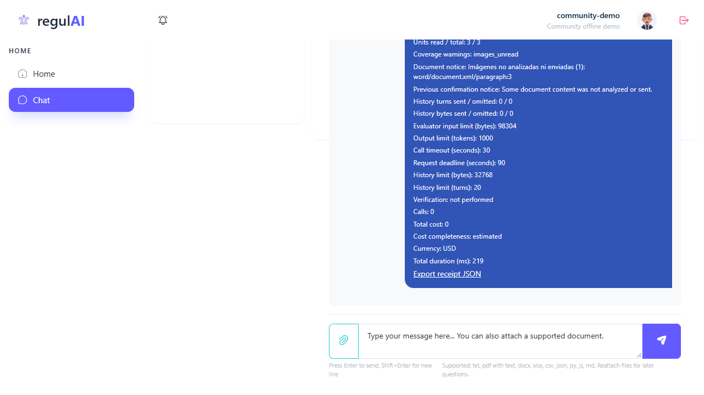

# P01 — revisión simulada del empleado de Alpha

**Revisión simulada completada; participación humana: 0.** P01 es un perfil ficticio, hispanohablante y poco técnico. No se ha entrevistado a una persona ni se ha validado el banco humano. H1 y H2 humanos siguen pendientes.

Se han recorrido analíticamente todos los pasos de [H1/H2](../../../docs/plan-blackhat/documentos-y-ensayos-piloto.md), incluidos aislamiento y estado/coste incierto del [piloto](../../../docs/plan-blackhat/piloto-controlado.md). [walkthrough.json](walkthrough.json) registra para cada paso: tarea/entrada, expectativa enlazada, evidencia anterior, acción nueva realmente realizada, resultado observable, inferencia simulada, duda y severidad. El vocabulario sigue en la [fuente única](../../../docs/plan-blackhat/README.md#vocabulario-que-utilizaremos).

## Qué se ha hecho realmente

- Lectura de corpus, protocolos, recibos, estados, snapshots y siete capturas históricas. Es revisión nueva de evidencia anterior, no repetición de sus acciones.
- Una comprobación nueva de navegador: subir `text-and-image.docx`, detectar la omisión, cancelar con Tab/Enter y descargar la ficha cancelada. Base, medios y sesión nuevos dentro del directorio privado P01; solo loopback.
- Extracción nueva de los doce documentos mediante el extractor público y expectativas congeladas: **12/12**. No hubo entrada HTTP nueva para esos doce casos, OCR, Office nativo ni evaluación semántica de proveedores.
- Comprobación de integridad/coherencia: **96/96**, incluyendo hashes de **73 archivos históricos**. Son comprobaciones de archivos y estados; no 96 pruebas de producto, 96 usuarios o 96 recorridos.

Resultados y fuentes exactas: [verification.json](verification01/verification.json), [extracción nueva](verification01/extraction.json), [manifiesto de entradas](verification01/source-manifest.json). Las expectativas conservan SHA256 `f3ccaaae8702e9043fb2c26e3a8ab22486a8af6a510870dc544d752261ef4c3c`.

## Comprobación nueva de cancelación documental

Se ejecutó Chromium headless 154.0.0.0 con Playwright CLI 0.1.22 a 1280 × 720. La identidad técnica fue **community-demo / Community offline demo**. No se cambió su empresa a Alpha: Alpha pertenece al perfil hipotético, no a la identidad usada por el navegador.

Entrada: `Cual es el precio del contrato?` con el Word sintético, SHA256 `38c43302be0249621eea168e77532edd326d9d8ae8e70e3bfd7a3fd9bd1ed315`. La petición `0d786fda-cbda-4397-af8c-e54ade766b7c` pasó de `pending_consent` a `cancelled`. El foco inicial estaba en Confirm sending; Tab lo llevó a Cancel request, una lectura DOM confirmó ese texto y Enter canceló.

[Estado pendiente](state-document-pending.json) y [cancelado](state-document-cancelled.json) conservan el mismo identificador, SHA, nombre y mensaje. Ambos tienen **cero llamadas**, **cero generaciones**; al final solo existe un mensaje de usuario y ninguno de asistente. La ficha declara `complete_text_only` y una imagen no analizada ni enviada en el párrafo 3.

El [recibo descargado](evidence/receipt-document-cancelled.json) procede del enlace real de la UI. No se reconstruyó. La máscara de esa base está configurada como local; **no se ejecutó**, porque la petición se canceló antes de las llamadas. No se convierte esta comprobación en una validación del detector.

La comprobación cierra la laguna documental H1.3: la evidencia histórica cancelaba un marcador sin archivo. La nueva sí cancela el Word adjunto mediante teclado. Sigue sin medir comprensión, ayuda o tiempo de una persona.

[Acciones y entorno](browser-observations.json), [comandos y códigos](commands.json), [fuentes cargadas](evidence/browser-source-manifest.json). El servidor se cerró con Ctrl+C (exit 1 voluntario), el navegador con exit 0 y el puerto 8781 quedó sin listener, comprobado a las 16:01:08 UTC: [limpieza](cleanup.json).

## Recorrido simulado y límites por escena

| Escena | Resultado comprobable y tipo de evidencia | Inferencia del perfil, no respuesta humana |
| --- | --- | --- |
| H1.1 / H2.1: saludo, simulación y ficha | Login/Chat nuevos correctos. Se leyó la prueba que espera Hola; no se envió ese saludo en esta revisión. | Las etiquetas en inglés y `engine:1` probablemente requieren ayuda para identificar destino y coste. |
| H1.2 / H2.6: secreto bloqueado | Se leyó el test de `SYNTHETIC_SECRET_DEMO` y la puerta histórica del laboratorio, que usa otro marcador. No hay bloqueo nuevo P01. | Debe detenerse ante bloqueo; una confirmación no levanta una prohibición. No se sabe si lo explicaría sin ayuda. |
| H1.3: omisión y cancelación | Nuevo caso de navegador: Word, aviso del párrafo 3, Tab/Enter, cancelled, cero llamadas. | La acción es accesible al agente; la comprensión de P01 sigue sin observarse. |
| H1.4: confirmar, dos intentos y cita | Recibo histórico: dos generaciones, failed y passed; ocho operaciones; 10 euros en párrafo 2. Se inspeccionó la cita conservada. | Puede confundir llamada completed con respuesta aceptada; el rechazo inicial está más claro en JSON que en el snapshot. |
| H1.5 / H2.4: guardar, recargar, reencontrar | Recarga y cita con teclado documentadas históricamente. Nueva descarga solo del recibo cancelado. | Guardar un JSON no implica entenderlo; el original debe adjuntarse otra vez para una pregunta documental posterior. |
| H1.6: XLSX sin/con caché | Extracción nueva: sin caché partial y con caché complete. Bloqueo por tres entradas HTTP consta en pruebas anteriores. | No debe entender el 10 de caché como recálculo de Excel ni asumir respuesta semántica nueva de la demo. |
| H1.7 / H2.6: móvil | Se inspeccionaron capturas históricas a 375 × 812; ancho medido entonces 375. No móvil nuevo. | La ficha extensa puede dificultar localizar coste/exportación aunque no haya desbordamiento horizontal. |
| H2.2: esperar y cancelar en otra pestaña | Hay caducidad histórica de 316,599294 s y cancelación separada de marcador. No acreditan una única sesión H2 multitarea. | Necesitaría reconocer qué petición está activa; no se ha observado autonomía. |
| H2.3: renovar consentimiento | Tres estados históricos conservan id/archivo/mensaje; cero llamadas hasta reconfirmar. Completada con una respuesta y aviso en pasado. | La renovación pide revisar el mismo contenido; no supone doble envío. La explicación es simulada. |
| H2.5: escaneo y cláusula final | Nueva extracción y revisión del mosaico previo: escaneo partial; PDF con blanco intermedio conserva 17 días en página 3. | Buscaría un documento textual; no debe prometer OCR ni atribuir una respuesta no programada a la demo. |
| Aislamiento Alpha/Beta | Puerta histórica del laboratorio registrada true; no sesión nueva Alpha/Beta. El navegador P01 usa la empresa de demo. | Una lista vacía no demuestra aislamiento completo; un dato ajeno exigiría parar. |
| Estado y coste inciertos | Reconstrucción UI y fallo real histórico del laboratorio revisados por separado: unknown, sin respuesta, generación started y coste null. | Desconocido no significa gratis ni éxito. Conservar request_id y pedir comprobación; no reenviar a ciegas. |

## Dudas de comprensión que merece la pena observar

Son **P2 de comprensión** según los criterios del piloto: no son opiniones recogidas, tasas de error ni fallos de seguridad demostrados.

| ID | Base observable | Hipótesis y siguiente observación útil |
| --- | --- | --- |
| P01-P2-01 | Botones, estados y gran parte de la ficha están en inglés; el aviso de imagen mezcla castellano y ruta XML. También aparecen `outcome_unknown`, `allow` y `not performed`. | Pedir a una persona que explique si salió contenido y qué haría después sin traducirle primero los controles. No se ha medido que P01 fracase. |
| P01-P2-02 | La ficha muestra `Units read / total: 3 / 3` junto con `complete_text_only` e imagen omitida. XLSX sin caché y escaneo son parciales por motivos diferentes. | Comprobar que distingue texto completo de documento visual completo, y caché de recálculo. Mostrar 3/3 no acredita lectura de la imagen. |
| P01-P2-03 | El JSON histórico distingue intento 1 failed e intento 2 passed. El snapshot renderiza ambas llamadas de generación como completed y un passed global. | Pedir que señale el intento rechazado sin abrir JSON ni recibir explicación. No se demuestra que el sistema muestre una respuesta rechazada como aceptada. |
| P01-P2-04 | Ficha extensa con límites técnicos, scroll vertical interno y exportación al final; coste/destino no quedan todos visibles en la captura móvil. | Observar si encuentra destino, coste y guardado; anotar ayuda real. No afirmar falta de acceso por teclado ni fallo WCAG a partir de la captura. |

La advertencia imperativa antigua tras caducar **ya está corregida** en el seguimiento: “Previous confirmation notice: A previous confirmation expired.” No se reabre como incidencia actual. El proceso histórico anterior que acabó en `classification_failed` se mantiene como fallo; no se transforma en éxito por existir una ejecución posterior correcta.

## Revisiones y procedencia

- Referencia inicial de documentos: `535eb9d8421006ea8476ea511427a7dcda9cee3b`. El manifiesto guarda los hashes de los blobs de planificación en esa revisión; root estaba actualizando su presentación al cierre.
- Comprobación nueva de navegador: referencia `972edb88c82a5220a43ffcc89316a9f9033e82f7`; se conservaron hashes de los ocho archivos cargados y la comprobación posterior coincidió.
- Navegador histórico: revisiones y hashes propios en los informes de documentos y seguimiento; no se les atribuye la revisión nueva.
- Laboratorio histórico 08: referencia `87311294631d9ffdf6b76ccf3fcb9140018a0977`. Su máscara de transporte y sus operaciones no se presentan como el detector local actual.
- La ejecución viva `698e8f0`, comunicada por root como parada tras clasificación incierta, pertenece a otro ensayo. Aquí no se repitió ni se amplió; ninguna conclusión de esta demo declara éxito vivo universal.

No se ha creado un commit propio ni modificado el índice Git, runtime, documentación compartida, banco humano o ledger. La [lista explícita de copia](public-artifacts.json) excluye DB, medios privados, claves, cookies, sesiones y ZIP. [artifact-sha256.json](artifact-sha256.json) contiene hashes de los archivos seguros.

## Resultado y pendientes

La simulación analítica está completa y el mecanismo de cancelación documental tiene evidencia nueva. El resultado humano de H1/H2 es **no evaluado**. El [formulario separado](formulario-simulado.md) contiene únicamente respuestas e intervenciones hipotéticas, rotuladas como tales.

Queda observar a participantes reales y medir sus acciones, ayuda y duración; completar H2 exacto con sus pestañas; comprobar comprensión de omisión, intento rechazado, coste desconocido y destino; observar aislamiento con las identidades previstas. No se mide satisfacción, ahorro, calidad semántica real, compatibilidad general Office, OCR, recálculo nativo ni accesibilidad universal. Ningún P0 o P1 se observó en el nuevo caso cancelado; ese alcance no permite afirmar que no existan en otros recorridos.

